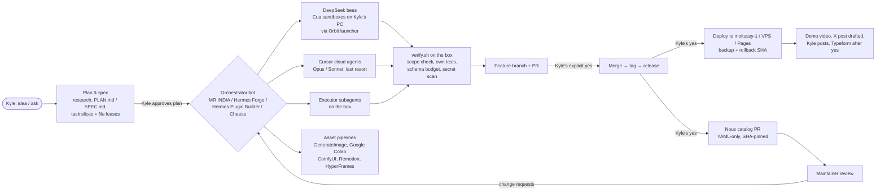

# Build workflow — Kyle Durepos (mojomast)

How Kyle and his agents plan, build, ship and host software, written down from what actually happened between mid-October and mid-November 2026. It covers the agents roster, the orchestration patterns (executors, Cursor cloud agents, DeepSeek "bees" in Cua sandboxes), the pipelines we built for assets and video, the infrastructure (the box, Orbit, Tailscale, moltussy-1, Google Colab, GitHub Pages), and the rules and lessons that came out of it.

Sources: the MR.INDIA bot's durable memory and shared memory (journal entries from MR.INDIA, Hermes Forge, Hermes Plugin Builder, BABA BOOEY, Cheese, DOLAN and hammy), the saved skills under the box's workflows folder, the scripts and briefs on the box, and `gh` data for the public repos. Teammate bots wrote their own accounts into [`contrib/`](contrib/). Nothing here is invented; where a source was missing, the doc says so.

Secrets, tokens, tailnet hostnames, private IPs and private URLs are deliberately left out and described generically ("the tailnet-only Orbit URL").

## The workflow at a glance

Every arrow labelled "Kyle's yes" is a hard gate: merges, tags, releases, deploys, catalog PRs, posts and form submits each need Kyle's own words, not another agent's relay. See [06 Rules and lessons](docs/06-rules-and-lessons.md).

## Index

| Doc | What's in it |
|---|---|
| [01 Planning and spec](docs/01-planning-and-spec.md) | How an idea becomes a researched plan, spec, task slices and file leases, and how approval works |
| [02 Assets](docs/02-assets.md) | Game art, the assetrizz library, banners, screenshots, video, voice, provenance and originality rules |
| [03 Development and orchestration](docs/03-development-and-orchestration.md) | Agents roster, executors, cloud agents, DeepSeek bees, Orbit, routines, briefing patterns, review → merge → release → catalog |
| [04 Pipelines](docs/04-pipelines.md) | Each pipeline used or built: inputs, tools, outputs, where it lives |
| [05 Infrastructure, hosting, networking](docs/05-infrastructure-hosting-networking.md) | The box, Orbit, Tailscale, Kyle's PC, moltussy-1, the VPS, GitHub Pages, Google Colab; deploy and rollback rules |
| [06 Rules and lessons](docs/06-rules-and-lessons.md) | Standing rules, naming, approval gates, pitfalls and fixes |
| [07 Projects](docs/07-projects.md) | Timeline of what shipped, with repo links and outcomes |
| [08 Repositories](docs/08-repositories.md) | Every repo we worked on, plus deep build histories of Eye Of Hermes, Temple of Hermes, assetrizz and the aircraft Doppler geolocation plugin |
| [contrib/](contrib/) | First-person accounts from the teammate bots, kept as written (after a secret scan) |

## Who "we" is

Kyle directs. MR.INDIA is his main Grok Bot and the general orchestrator. Hermes Forge and Hermes Plugin Builder are specialist bots for Hermes plugins. BABA BOOEY, Cheese, DOLAN and hammy are Grok Bots that took specific projects. Hermes (Nous Research's agent) and Pi run as agents inside Orbit. Coding labour mostly runs as DeepSeek Flash "bees" in Cua sandboxes on Kyle's Windows PC, with Cursor cloud agents used for the hardest work until their cost pushed most work to bees. Details in [03](docs/03-development-and-orchestration.md).
