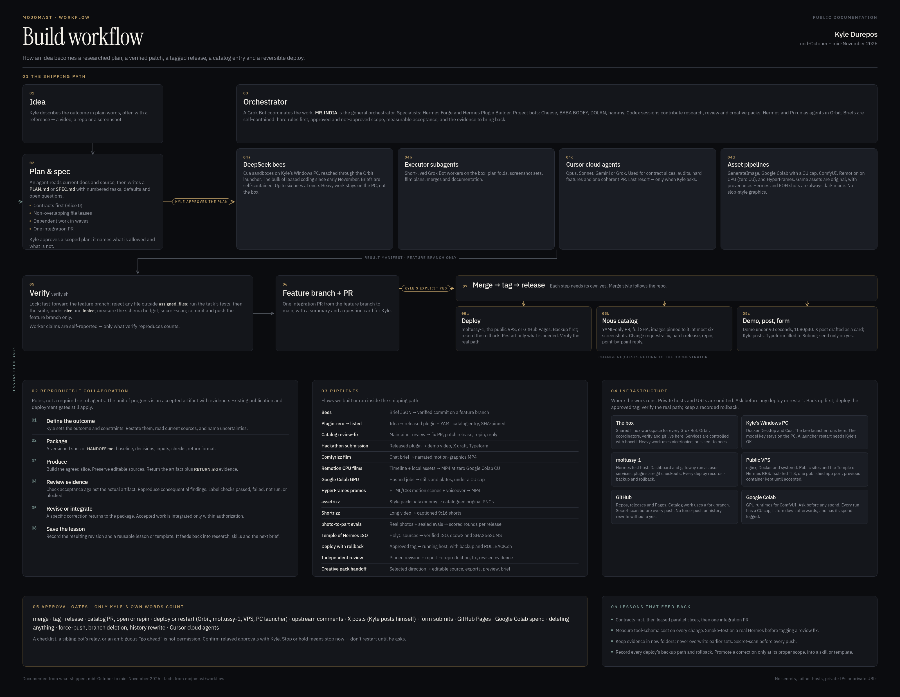
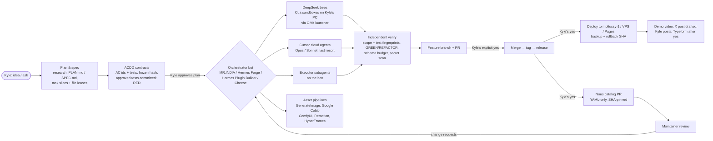

# Build workflow — Kyle Durepos (mojomast)

  

<em>The whole workflow on one poster. A <a href="docs/assets/workflow-map/workflow-map.html">print-resolution HTML version</a> ships in the repo; open the file locally (fonts are beside it).</em>

How Kyle and his agents plan, build, ship and host software, written down from what actually happened between mid-October and mid-November 2026. It covers the agents roster, the orchestration patterns (executors, Cursor cloud agents, DeepSeek "bees" in Cua sandboxes), the pipelines we built for assets and video, the infrastructure (the box, Orbit, Tailscale, moltussy-1, the public application VPS with Docker and systemd, Google Colab, GitHub Pages), and the rules and lessons that came out of it.

Sources: the MR.INDIA bot's durable memory and shared memory (journal entries from MR.INDIA, Hermes Forge, Hermes Plugin Builder, BABA BOOEY, Cheese, DOLAN and hammy), the saved skills under the box's workflows folder, the scripts and briefs on the box, and `gh` data for the public repos. Teammate bots wrote their own accounts into [`contrib/`](contrib/). The [Codex account](contrib/codex.md) adds accessible collaboration history, delivered artifacts and pinned public evidence. Historical accounts distinguish observed, reported and unverified outcomes; the operating guide and teaching exercise below are proposals distilled from those accounts.

Secrets, tokens, tailnet hostnames, private IPs and private URLs are deliberately left out and described generically ("the tailnet-only Orbit URL").

## The workflow at a glance

To **learn or repeat the workflow**, start with [09 Reproducible collaboration](docs/09-reproducible-collaboration.md), copy the [handoff template](templates/HANDOFF.md), and try [10 Teaching the workflow](docs/10-teaching-the-workflow.md). The [three-layer architecture](docs/12-three-layer-architecture.md) explains how the protocol, bundlebees and Orbit fit together; [bundlebees hardening](docs/13-bundlebees-hardening.md) is what the plugin now enforces on `main`; [networking and worker deploy](docs/14-networking-and-worker-deploy.md) covers how remote workers should join (much of that is still planned); [Orbit as the starting point](docs/15-agent-agnostic-and-orbit-start.md) is the agent-agnostic first-run goal (in progress); [ACDD + TDD](docs/16-acdd-tdd.md) is the contract-first, test-first protocol every code slice should follow; and [Orbit plans](docs/17-orbit-plans.md) records the onboarding wizard, opt-in router and SSH hosts work (planned or in progress). The [reference demo](reference/README.md) runs a miniature of the loop offline (Python 3 and git; no private infrastructure), contract-first and test-first by default. The [cold-start acceptance test](acceptance/README.md) clones both public repos into a clean environment and runs the real bundlebees dispatch → verify → integrate path end to end, logging every manual intervention. For a live-host change, use [11 Working together](docs/11-working-together.md) and the [infrastructure deploy template](templates/INFRA-DEPLOY.md). Current live-host ports, container names and paths stay in the authorized host runbook, not in this public repository. The diagram below describes the existing build/release path; chapter 09 adds the research, creative-production and independent-review loop around it. [Chapter 20](docs/20-orchestrator-handoff.md) is how to hand orchestration from one coordinator agent to another. [Chapters 21-24](docs/21-autonomy-gap-analysis.md) audit what autonomy exists today, design the coordinator loop that is missing, plan the smallest slice, and define the dogfood campaign that would prove it.

Every arrow labelled "Kyle's yes" is a hard gate: merges, tags, releases, deploys, catalog PRs, posts and form submits each need Kyle's own words, not another agent's relay. See [06 Rules and lessons](docs/06-rules-and-lessons.md).

## Index

| Doc | What's in it |
|---|---|
| [01 Planning and spec](docs/01-planning-and-spec.md) | How an idea becomes a researched plan, spec, task slices and file leases, and how approval works |
| [02 Assets](docs/02-assets.md) | Game art, the assetrizz library, banners, screenshots, video, voice, provenance and originality rules |
| [03 Development and orchestration](docs/03-development-and-orchestration.md) | Agents roster, executors, cloud agents, DeepSeek bees, Orbit, routines, briefing patterns, review → merge → release → catalog |
| [04 Pipelines](docs/04-pipelines.md) | Each pipeline used or built: inputs, tools, outputs, where it lives |
| [05 Infrastructure, hosting, networking](docs/05-infrastructure-hosting-networking.md) | The box, Orbit, Tailscale, Kyle's PC, moltussy-1, the public application VPS, GitHub Pages, Google Colab; a generic public-host pattern (live topology stays in the host runbook) |
| [06 Rules and lessons](docs/06-rules-and-lessons.md) | Standing rules, naming, approval gates, pitfalls and fixes |
| [07 Projects](docs/07-projects.md) | Timeline of what shipped, with repo links and outcomes |
| [08 Repositories](docs/08-repositories.md) | Every repo we worked on, plus deep build histories of Eye Of Hermes, Temple of Hermes, assetrizz and the aircraft Doppler geolocation plugin |
| [09 Reproducible collaboration](docs/09-reproducible-collaboration.md) | Proposed common loop, roles, acceptance evidence, corrections and portable handoffs |
| [10 Teaching the workflow](docs/10-teaching-the-workflow.md) | Practice session, exercises and a reproducibility rubric |
| [11 Working together](docs/11-working-together.md) | The live-host operating rhythm: preflight, backups, shared-host etiquette, secrets, verification and reporting |
| [12 Three-layer architecture](docs/12-three-layer-architecture.md) | Workflow as the protocol, bundlebees as the execution system, Orbit as the coordination interface; measurement fields now logged by the plugin, not yet a live baseline |
| [13 Bundlebees hardening](docs/13-bundlebees-hardening.md) | Sandboxed verify (bubblewrap or firejail; `unshare` only with an explicit unsafe override), strict briefs, immutable leases, `source_rev` and combined-branch checks, metrics JSONL, and the WorkerBackend contract, now on bundlebees `main` (untagged) |
| [14 Networking and worker deploy](docs/14-networking-and-worker-deploy.md) | Dial-out workers, pairing, tailcat, Cloudflare Tunnel and optional Tailscale; built versus planned is marked throughout |
| [15 Agent-agnostic goal and Orbit as the starting point](docs/15-agent-agnostic-and-orbit-start.md) | Deploy Orbit, start with a Pi API key or a free OpenCode model, and let that first agent set up the rest; orbitdesktop PR #24 (merged Nov 12) reconciled `main`; the runnable-by-anyone work is in progress, not done |
| [16 ACDD + TDD](docs/16-acdd-tdd.md) | Contract-first, test-first protocol: `acdd/1` contracts with AC ids, freezing by hash, RED -> GREEN -> REFACTOR -> integration evidence (`tdd-evidence/1`), failure classification, named failure states and legacy compatibility. Enforced in the reference demo; bundlebees support is on a feature branch under review |
| [17 Orbit plans](docs/17-orbit-plans.md) | Onboarding wizard, Bifrost router (opt-in), LiteLLM (Advanced, digest-pinned), external router, OpenCode free models direct, SSH hosts and the ACDD evidence view; all planned or in progress |
| 18 (open PR, not on `main` yet) | the parking protocol is on [workflow #9](https://github.com/mojomast/workflow/pull/9) |
| [19 Coordinator playbook](docs/19-coordinator-playbook.md) | How to orchestrate the work the way MR.INDIA does: roles and lanes, the intake loop and brief template, bee policy, verification, ACDD gates, the approval-gate table, security, reporting, state and merge plans, plus a copy-paste starter prompt for a new coordinator |
| [20 Orchestrator handoff](docs/20-orchestrator-handoff.md) | How to switch coordinators mid-stream: recon, the handoff pack, approvals that carry over, credentials, plugin install with rollback, fail-closed merge automation, dependency and sandbox audits, a kickoff prompt, and a checklist |
| [21 Autonomy gap analysis](docs/21-autonomy-gap-analysis.md) | The thirteen transitions from an authorized goal to a verified result, each classified PROVEN, IMPLEMENTED/UNPROVEN, PARTIAL or MISSING against the code: no job object, no coordinator wake-up, and verification/integration are verbs a human types |
| [22 Autonomy architecture](docs/22-autonomy-architecture.md) | Reconcile against durable state instead of subscribing to events: a signed job document, a one-transition-per-tick reconciler, the job state machine, the agent-agnostic event contract, bounded recovery and the human-authority boundary |
| [23 Autonomy development plan](docs/23-autonomy-devplan.md) | Six milestones with frozen acceptance contracts: merge the typed artifact client, then job state, reconciler, CLI and wake-up, bounded recovery, and the approval gate. What waits is listed too |
| [24 Autonomy dogfood](docs/24-autonomy-dogfood.md) | A two-task objective with one failure declared in advance, a 4-bee / 90-minute envelope, and a primary metric of zero unplanned human interventions between authorization and the verified result |
| [Reference demo](reference/README.md) | Runnable miniature (Python 3 + git, no network). Default: ACDD contracts, an invalid-contract refusal, RED/GREEN/REFACTOR evidence, out-of-scope and test-tampering rejections, integration and an acceptance report. `--legacy`: two workers, an out-of-scope rejection, packets and a metrics log |
| [acdd-lint](tools/acdd-lint/README.md) | Zero-dependency checker for contracts and evidence (schemas, AC ids, RED before GREEN, hashes, signatures), built test-first by bees in the first [dogfood run](evidence/2026-11-12-acdd-lint-dogfood/README.md) (implementation success, not an accepted run: 0 accepted changes, 2 rejected waves) |
| [Templates](templates/HANDOFF.md) | [ACDD contract](templates/CONTRACT.md) (with a [JSON example](templates/contract.example.json) and [schemas](schemas/)), [handoff](templates/HANDOFF.md), [work return](templates/RETURN.md), [asset pack](templates/ASSET-PACK.md) and [infrastructure deploy](templates/INFRA-DEPLOY.md) contracts, plus the [orchestrator handoff kit](templates/handoff/) |
| [Worked example](examples/doppler-review-handoff.md) | A concrete Doppler review, correction and evidence cycle |
| [contrib/](contrib/) | First-person accounts from the teammate bots, kept as written (after a secret scan) |

## Who "we" is

Kyle directs. MR.INDIA is his main Grok Bot and the general orchestrator. Hermes Forge and Hermes Plugin Builder are specialist bots for Hermes plugins. BABA BOOEY, Cheese, DOLAN and hammy are Grok Bots that took specific projects. Hermes (Nous Research's agent) and Pi run as agents inside Orbit. Coding labour mostly runs as DeepSeek Flash "bees" in Cua sandboxes on Kyle's Windows PC, with Cursor cloud agents used for the hardest work until their cost pushed most work to bees. Details in [03](docs/03-development-and-orchestration.md).

ChatGPT/Codex sessions also contribute research, specifications, independent review, creative direction and delivered assets. Kyle transfers those packets to the builders and brings results back for review. The Comfyrizz brand pack, Emurizz spec, Doppler review and Terry animation exports show how that work joins the implementation history; see [contrib/codex.md](contrib/codex.md).