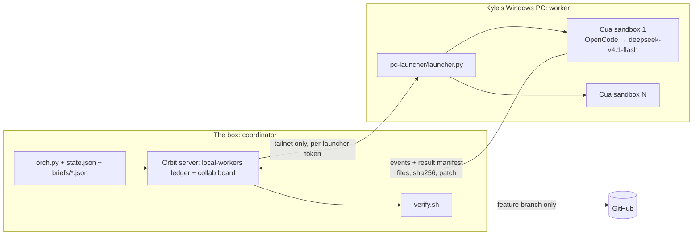
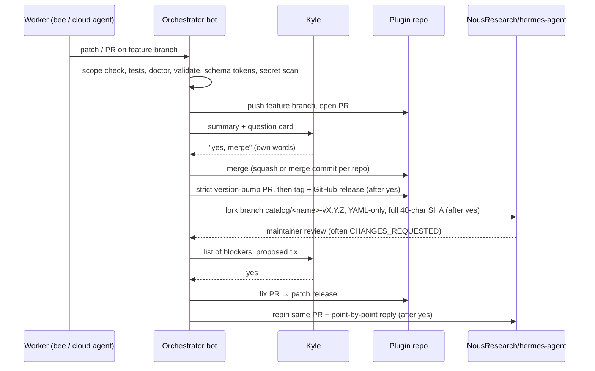

# 03 — Development and orchestration

How the coding actually gets done: who the agents are, how work is handed to them, how results are verified, and how a change travels from a feature branch to a merged Nous catalog entry.

## 1. Agents roster

| Agent | Kind | Role in practice |
|---|---|---|
| **Kyle** | Human | Sets goals, approves plans, gives every merge/tag/release/deploy/catalog/post/form yes. Posts on X himself |
| **MR.INDIA** | Grok Bot (main) | General orchestrator and Kyle's main chat. Ran Orbit deploys, Comfyrizz, EOH's first releases, assetrizz, bundlebees, hackathon submissions, catalog slot management, box housekeeping |
| **Hermes Forge** | Grok Bot (specialist) | "Builds Hermes plugins and ships them with Cursor cloud agents plus Orbit DeepSeek Flash bees." Owns Temple of Hermes and hermes-templeos, Hermagotchi's first submission, several shortrizz releases. See [contrib/hermes-forge.md](../contrib/hermes-forge.md) |
| **Hermes Plugin Builder** | Grok Bot (specialist) | Created Nov 6 with the `hermes-plugin-development` skill and Kyle's rules in its persona. Ran EOH and poptart review-fix cycles, Hermagotchi and stitchslop fixes, EOH audit PRs and v0.2.8–v0.2.10. See [contrib/hermes-plugin-builder.md](../contrib/hermes-plugin-builder.md) |
| **BABA BOOEY** | Grok Bot | Pizza Panic bosses (and the Machine Beneath the Skin), then photo-to-part (v0.1.0 → v0.1.22) and its showcase video. See [contrib/baba-booey.md](../contrib/baba-booey.md) |
| **Cheese** | Grok Bot | Pizza Panic gamepad support and QA; orchestrated Emurizz (SNES/N64 netplay pane) with a bee routine. See [contrib/cheese.md](../contrib/cheese.md) |
| **DOLAN** | Grok Bot | Pizza Panic end screens and credits; aircraft-doppler-geolocation releases and catalog PRs |
| **ChatGPT / Codex collaboration sessions** | Research, review and creative-production assistants | Research/specs, source review, reproduction of review findings, brand and animation packs, and briefs Kyle passes to builders. Documented examples in [contrib/codex.md](../contrib/codex.md); implementation/release ownership remains with the builders |
| **hammy** | Grok Bot | Took delegated tasks such as Comfyrizz PR #76 merge + docs, first-frame/thumbnail work on shortrizz and hyperrizz, and building Buffrizz via a cloud agent |
| **COLAB ORCHESTRATOR** | Grok Bot | Owns the Google Colab app in Orbit (Orbit PR #18); runs Colab GPU jobs; reviewed Comfyrizz branches |
| **ComfyUI Agentic Research**, **Demo Hosting Research**, **Judge Demo Compute Research** | Grok Bots (research) | Focused research teammates for Comfyrizz questions; ComfyUI Agentic Research built the open-higgsfield-skills collection and its video-director skill |
| **Hermes** | Nous Research agent (runs on the box and on moltussy-1) | Agent provider for Orbit; the host every plugin targets; member of the asylum chat |
| **Pi** | Agent in Orbit | Member of the asylum chat; judged Comfyrizz stills via DeepSeek vision in the ref-watch plan |
| **Executor subagents** | Short-lived Grok Bot workers on the box | Plan folds, screenshot sets, film plans, merges, docs (like this one) |
| **Cursor cloud agents** | Cursor-hosted coding agents (Claude Opus 5.5 / Sonnet 5.5, Gemini, Grok) | Contracts slices, audits, hard features, single coherent PRs |
| **DeepSeek bees** | OpenCode agents in Cua sandboxes on Kyle's PC | The bulk of leased coding tasks since early November |

Group chats: in October the agents worked together in the Orbit group chat **"THE INSANE ASSYLYM"** (Hermes, Pi, MR.INDIA, BABA BOOEY, DOLAN, Cheese) on Pizza Panic, with a collaboration board each agent pulled tasks from.

## 2. Choosing who does the work

The routing rule changed over time, always for cost or reliability:

| Period | Default for coding | Why |
|---|---|---|
| Oct 13–20 | Hermes and Grok Bots in Orbit Collab; a few Cursor cloud agents | Orbit Collab was the product being built |
| Oct 20–23 | Bees on free OpenCode models (minimax-m3.1-flash-free, beam-free, glm-5.3-flash-free), paid deepseek-v4.1-flash only as fallback | Kyle wanted cheap parallel workers; free models stalled (two stalled together on Oct 21; minimax stalled reading PNGs) |
| Oct 23 | Order: beam-free → glm-5.3-flash-free if better → paid deepseek-v4.1-flash; agy Gemini/Sonnet/Opus for complex work; **Cursor cloud agents last resort** | Kyle objected when stalled bees were bulk-moved to paid DeepSeek; beam-free capped at 5 concurrent |
| Oct 26–27 | Cursor cloud agents on Claude Opus 5.5 / Sonnet 5.5 for Comfyrizz UX waves, DeepSeek bees for leaf tasks | Hackathon deadline; Kyle asked for usage reports as agents progressed |
| Nov 5 onward | **Orbit bees (DeepSeek Flash)**, not Cursor cloud agents | Cloud agents used about 30% of Kyle's monthly allotment in one day |
| Nov 9 onward | Resource-heavy work (tests, renders, Blender, heavy image processing) goes to bees, not the box | Keep the shared box responsive |
| Nov 11 | MR.INDIA may run up to 6 of its own bees at once (was 2) | Kyle's explicit raise |

Cursor cloud agents were still used when a coordinator needed one coherent PR (Hermes Forge's first templeos slices; MR.INDIA's EOH waves on Nov 5–6; hammy's Buffrizz). Kyle's later rule is that cloud agents need his explicit ask.

## 3. Executor subagents

An executor is a Grok Bot subagent started on the box with a self-contained brief. Uses seen in memory: folding review findings into a plan (`PB01–PB07` into the Comfyrizz UX remediation plan), writing a film plan for a hackathon demo, capturing matched 1080p "before" and "after" screenshot sets around an overnight UI wave, merging a finished cloud-agent PR and unlocking bees. Subagents report progress phases to Orbit through `~/bin/agent-status` (a tiny loopback-only script that never blocks or fails), and Orbit's ⚡ Activity panel shows them under "◈ Subagents".

## 4. DeepSeek bees (Cua sandboxes on Kyle's PC)

**Architecture** (from the public [orbitdesktop](https://github.com/mojomast/orbitdesktop) `docs/LOCAL_WORKERS.md` and the shared bees setup prompt):

- The launcher is a small Python HTTP service on Kyle's PC (Docker Desktop, Cua SDK pinned at 0.5.0, sandbox image pinned by digest). Per brief it creates a fresh Linux sandbox, clones the authorized repo inside it, runs Cua's OpenCode harness on `deepseek-v4.1-flash`, streams events and returns a result manifest (changed files with sha256, the patch, the worker's self-reported checks).
- The model key lives only on the PC. Orbit holds only a per-launcher token. Workers run with subagents disabled; the sandbox is the security boundary. Nothing on the PC filesystem is mounted.
- Projects must be on the launcher's allow-list; authorizing a new repo means restarting the launcher, which needs Kyle's OK (e.g. the Nov 11 restart that authorized bundlebees and assetrizz-hermes).
- Attempt states map onto board columns (`todo`, `doing`, `review`, `blocked`, `done`). Orbit and launcher restarts reattach by attempt id and never re-dispatch.
- Launcher capacity moved from 1 → 3 → 6 → 10 slots across October (the box keeps dated backups of `orbit-start.sh` for each change).

**Coordinator scripts.** Each project got a folder on the box with `orch.py` (`status`, `dispatch` deps-ready tasks up to `MAX_ACTIVE`, `set`, `card` to mirror tasks onto the collaboration board), `state.json`, `briefs/*.json` and `verify.sh`. Examples: bundlebees, Temple of Hermes, Hermagotchi, Emurizz.

**verify.sh** (bundlebees version, typical of all):
1. Take a lock so only one verify runs.
2. Fast-forward the feature branch.
3. Extract the patch from the result manifest and **reject it if any file is outside `assigned_files`** or the patch is empty.
4. `git apply --check`, then apply.
5. Run the task's own tests, then the suite, under `ionice -c3 nice -n 10`.
6. Run the schema measurer and fail if the tool schemas exceed the budget (900 o200k tokens for bundlebees).
7. Secret-scan the added lines (CGNAT `100.64/10` IPs, `.ts.net`, home/workspace paths, Windows user paths, `sk-`, `ghp_`, AWS keys, private-key headers, inline API keys).
8. Commit and push the **feature branch only**, then mark the attempt accepted.

**Bee rules that came from failures:**
- Worker claims are self-reported; only what verify reproduces counts.
- A bee with no new events for more than 20 minutes may be cancelled and redispatched once, but check the launcher first: launcher blips have flushed 30 minutes of buffered events at once (Hermes Forge).
- Serialize sandbox seeding: parallel `git fetch` against the PC clone timed out at 120 s and looked like bee failures (Cheese).
- Don't commit inside the sandbox: a local commit makes `git diff HEAD` empty and the patch blank; copy output out before the sandbox is reaped (Hermes Forge).
- Never run duplicate verifies while an orchestrator routine is also verifying (Comfyrizz, Oct 21: load around 48, same patch applied twice).
- Sandboxes only get a git archive, so host fixture paths are invisible to bees (Cheese).
- On Oct 22 Kyle's PC ran low on memory and the launcher died (Docker backend leaked to 26 GB plus a local llama-server); restarting Docker Desktop is the fix.

The whole setup was packaged twice: as an agent-agnostic **bees setup prompt** Kyle shared with a friend on Nov 11 (phases 0–3 plus hard rules), and as the Hermes plugin **[bundlebees](https://github.com/mojomast/bundlebees)** (four tools, worker launcher, briefs, leases, verify).

## 5. Orbit

[Orbit Desktop](https://github.com/mojomast/orbitdesktop) is Kyle's agent-shaped browser desktop powered by Hermes, and it doubled as the coordination layer: the Grok Bots app (chat with Grok Bots, Hermes and Pi, group chats with @mentions, live ⚡ Activity), the Collab app and collaboration board (`~/bin/collab-board` CLI), the Google Colab app, and the local-workers adapter that talks to the PC launcher. A separate public repo, [orbit-control-plane](https://github.com/mojomast/orbit-control-plane), is an observability dashboard for boards, workers and chat. Deploy rules are in [05](05-infrastructure-hosting-networking.md).

## 6. Routines

Routines are scheduled agent runs. The ones in memory:

| Routine | Owner | What it did |
|---|---|---|
| Pizza Panic board keeper | MR.INDIA | Kept the collaboration board stocked and nudged idle agents; state in a JSON file of completed task ids and last nudge. Nudges paused when Kyle wrapped up (Oct 15) |
| Comfyrizz worker orchestrator | MR.INDIA | status → verify finished bees → dispatch deps-ready tasks |
| Overnight game-asset keeper | MR.INDIA | Watched the 12 generation workers, announced 1,000 and 2,000 asset milestones with contact sheets, restarted stuck workers; window ended 5 AM ET Nov 10 |
| `emurizz-bee-orchestrator` | Cheese | Every ~10 min in agreed hours: refresh, verify, merge to feature branch, dispatch. Paused as of Nov 12 |
| Qwen4 weights watch | MR.INDIA | Weekdays ~9 AM ET: check Hugging Face, ModelScope and Qwen posts for Qwen4 weights; message only on news; ends Dec 31 |

The bees setup prompt recommends a 5–15 minute loop: status → verify finished → dispatch deps-ready → report what changed.

## 7. Briefing and prompting patterns

Every brief is self-contained because workers can't ask questions. Paraphrased real examples:

**Bee brief (bundlebees BB01, JSON).** Title, model and fallback, project, branch. The objective opens with hard rules: change only assigned files; write the test first and confirm it fails; tests offline with fakes (no network, tokens, Docker or SSH); every tool returns a JSON string envelope with `ok`/`error`/`code`/`fix`; secrets only through Hermes's secret scope; minimal child-process environment; path confinement; never print tokens, private URLs or hosts; don't bump the version or add a catalog entry; never merge, tag, force-push or deploy. Then a `<decisions>` block: what Kyle approved (repo, branch, PR after integration) and what he did not (merge, tag, release, catalog PR, launcher restart, deploys, cloud agents), and design decisions D1–D4 (leases file, four tools under 900 o200k tokens, no target URL as a tool argument, kanban via documented APIs only). Then the task and the files to write.

**Feature brief for a cloud agent (EOH promo restyle).** Mission in one line; repo, branch, files; a "keep exactly as they are" list (real footage, scene order, voiceover sync, no placeholders, real numbers); the problem stated plainly ("reads as a generic tech promo"); a committed visual direction ("Cartographer's field instrument": palette hex values, type rules, graphic system, motion rules, texture limits); process (write `STYLE.md` first, render 4–6 key frames, then full render, then QC including a grep for placeholder strings); deliverables; "ask before merging".

**Handoff brief from a live session (EOH, Nov 5).** Environment, then P0/P1/P2 problems each with the exact tool or behaviour wanted, acceptance tests with numbers (8 pins survive reopen, ≥10 POIs, ≤3 agent calls for a tour) and a do-not-regress list.

**Process brief for another bot (hackathon submission).** Official rules with source link, the form's fields, the deadline, step list (confirm catalog PR pin → make or find video to spec → draft X post as a card for Kyle → Kyle posts → fill the form, stop before Submit, screenshot, submit only on Kyle's yes → report), and rules. MR.INDIA reused this one brief for Hermes Plugin Builder (poptart) and Hermes Forge (Hermagotchi).

**Off-host agents need public context.** BABA BOOEY learned that box paths are useless to a remote agent; putting the brief and assets on a public GitHub branch with raw URLs is what unblocked the photo-to-part video agent.

Common patterns: hard rules first; "feature branch only"; approved/not-approved scope inline; measurable acceptance; carry-over findings from failed attempts written into the next brief; ask for evidence (SHA, test counts, paths) rather than claims; tell workers to mark unexecuted gates unproven instead of mocking success.

## 8. Review → merge → tag → release → catalog

Details that matter:
- Comfyrizz squash-merges to main with no tag; Temple of Hermes repos use merge commits and annotated tags; plugin version bumps go through a script that only rewrites `version:` and refuses duplicate keys.
- Catalog entries are a single YAML file with a full SHA, images pinned to the same SHA, at most 6 screenshots; validate with `scripts/validate_plugin_catalog.py plugin-catalog/<slug>.yaml` and `hermes plugins validate <plugin> --install-deps`.
- If `gh` gets a CreatePullRequest permission error, push the fork branch and Kyle opens the PR in the GitHub UI.
- Kyle can have at most 5 open catalog PRs; closing one to free a slot (shortrizz #148687, photo-to-part #148018 on Nov 9) is not a verdict.
- Reviews can arrive after approval ("a correction to our approval" after a full-tree read), so budget a fix → release → repin → reply cycle.
- Before tagging a review fix, smoke-test in a real Hermes (0.23.0 for the Nov 12 photo-to-part and bundlebees fixes).
- The `hermes-plugin-development` skill (published in [hermes-plugin-dev](https://github.com/mojomast/hermes-plugin-dev)) holds the full checklist and every catalog review lesson.

## 9. Approval gates (summary)

Need Kyle's explicit yes, in his own words, each time: merge, tag, release, deploy or restart (Orbit, moltussy-1, VPS, PC launcher), catalog PR open or repin, upstream comments, X posts (Kyle posts himself), form submits, GitHub Pages deploys, Google Colab spend, deleting anything, force-push, branch deletion, history rewrite, cloud agents. "Stop" or "hold" means stop now and don't restart. A relayed approval from another bot must be confirmed with Kyle directly.

## 10. Review across agents

The Doppler work adds a review path around the build: Codex inspected a pinned revision, Kyle passed the implementation brief to DOLAN, DOLAN returned a PR and measurements, and Codex reproduced two defects before the fixes landed. The receiver needs a base/head, evidence and explicit remaining limits. [09](09-reproducible-collaboration.md) and the [return template](../templates/RETURN.md) formalize that exchange without requiring another orchestration platform or a fixed number of agents.
