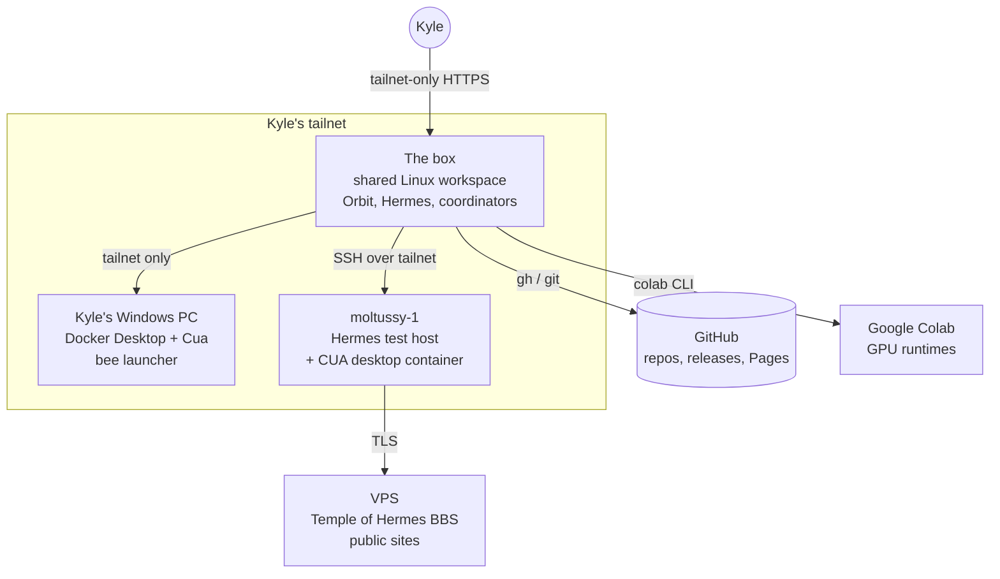

# 05 — Infrastructure, hosting, networking

Machines, services and how things get deployed. Hostnames, IPs, ports bound to private networks, tokens and private URLs are left out on purpose.

## 1. Map

## 2. The box

A single persistent Linux machine shared by all of Kyle's Grok Bots (same filesystem; each agent has its own desktop). Everything coordinator-side runs here: git checkouts, `orch.py`/`verify.sh`, secret scans, schema measurement, Remotion renders, image post-processing and these docs.

- **No systemd.** Services are kept alive by `~/bin/box-supervisor`, started from a shell hook, and controlled with `~/bin/boxctl status | start | stop | restart <service>`. Managed services: tailscaled, tailscale serve, Hermes gateway, Hermes dashboard, Orbit, and the Grok Bot bridges. `boxctl stop` writes a "disabled" marker so the supervisor won't bring a service back.
- **Hermes on the box** runs gateway and dashboard with `deepseek-v4.1-flash` through OpenCode Go.
- **Grok Bot plumbing**: a local Sand gateway plus an OpenAI-compatible bridge let Orbit talk to Grok Bots. Kyle's rule: read-only gateway endpoints are fine; mutating calls (create agent, send prompt, interrupt, automations, widget/permission responses) need his explicit permission, and the gateway token is never exposed.
- **Load and disk.** Heavy work is run under `nice`/`ionice` or sent to bees. Reading large PNGs on the box has timed out and overloaded it. The 128 GB disk filled to 97% twice in November; cleanup (temp folders, caches, old builds, a voice-tool environment) is done only with Kyle's OK for anything beyond throwaway temp files.
- **Box health.** `box-doctor` checks machine-id, Chrome, DNS/egress, clock and D-Bus.

## 3. Orbit (on the box)

[Orbit Desktop](https://github.com/mojomast/orbitdesktop) runs on the box and is reached only over a tailnet-only HTTPS URL (Tailscale serve proxies to the local server). Kyle asked for Tailscale access on day one (Oct 13).

**Orbit deploy rules** (recorded Oct 13, used for every deploy):
1. Ask Kyle first.
2. Build with Node 22 first on `PATH` (Node 20 breaks `better-sqlite3`), `npm ci`, build.
3. Copy the build into `dist` manually, keeping a numbered backup (`dist.prev2`, `dist.prev3` …).
4. `boxctl restart orbit`.
5. Verify the server really boots: `/api/health` returns 200 and nothing crashes for 60 seconds.
6. Record the rollback: `git reset --keep <previous SHA>` plus the matching `dist.prevN`.

Live Orbit ran from local integration branches (`integ-deploy-2`, `integ-deploy-3`, `integ/live-tree-oct14`) that combined open PRs, with nothing pushed until reviewed.

## 4. Tailscale

- Orbit, the PC launcher and moltussy-1 are reachable only inside Kyle's tailnet. The PC launcher binds to its tailnet address with a Windows firewall rule limiting it to Tailscale.
- MagicDNS names can go stale: on Oct 24 Orbit's public origin had to move to a new node name because the old node was offline.
- Nov 5: the box's Tailscale CLI broke (missing daemon socket) and `openssh-client` was missing, which blocked a moltussy-1 deploy. Fix: restart tailscaled; install the SSH client from Debian packages over HTTPS.

## 5. Kyle's Windows PC (bee worker)

Windows with Docker Desktop and the Cua SDK. Runs the Orbit local-workers launcher (start/stop/status/doctor/probe PowerShell scripts in the launcher folder). The model key and the launcher's token files live only there with user-only permissions. Capacity rose to 10 slots. Don't restart the launcher without Kyle's OK (authorizing a new repo requires a restart). Memory pressure once killed it (Docker backend leak plus a local llama-server); restart Docker Desktop if that recurs.

## 6. moltussy-1 (Hermes test host)

Kyle's Linux host for live Hermes tests, reached by SSH over the tailnet.
- Hermes **dashboard**, **gateway** and the Hermes Webapp run as `systemctl --user` services; plugins are git checkouts symlinked into `~/.hermes/plugins/<name>` (some install a subdirectory).
- God's Eye View runs there as a user service for EOH.
- Nov 4: set up with a CUA desktop container (XFCE, restart unless-stopped, token-protected API and a password-protected noVNC viewer) so bees could use it as a development machine; the service user was made a sudoer and added to the docker group. Shortrizz and Comfyrizz were set up there the same as on the box.
- Deploy pattern: [04 §14](04-pipelines.md#14-deploy-with-rollback). Every deploy recorded a backup under `~/.hermes/backups/<plugin>-<timestamp>/` and a rollback SHA or `ROLLBACK.sh` in chat and memory.
- After a test, restore only what the test changed: Eye Of Hermes stays disabled there unless Kyle asks, and layers he turned off stay off.
- Restarting the Hermes services kills a running TempleOS VM and BBS relay; snapshot what's running and restore it.
- Hermes Desktop can keep serving a stale pane after a deploy until Capabilities → Plugins → Rescan.

## 7. VPS and public sites

| Site | What | Notes |
|---|---|---|
| `toh.rizz.click` | Temple of Hermes BBS (HBBS/1 over TLS) | Containerized; v0.1.3 deployed Nov 11 with the previous container kept and a backup taken; live sign-up and digest tested from Kyle's PC |
| `comfy.rizz.click` | Comfyrizz public marketing site | A separate, tokenized invite link (per-link Google Colab CU budget and TTL) gives judges/friends a live workspace; the token path is private |
| `hermes.rizz.click` | Planned host for the hackathon showcase site | MR.INDIA wrote a deployment prompt for Kyle's VPS agent; the static site is built by `node src/build.mjs` with relative paths; showcase PR #1 review and Pages are pending Kyle |
| [mojomast.github.io/clawpocalypse-now](https://mojomast.github.io/clawpocalypse-now/) | The game, on GitHub Pages | Main branch serves Pages |

Pitfall: the game's `deploy.sh` rsynced from an older local game folder and would have rolled back newer work (and rsync wasn't installed). Check that a deploy script's source path matches the repo before running it.

## 8. Google Colab

GPU (mostly G4) for ComfyUI generation. Rules: ask before any spend; every run has a CU cap; tear the session down and confirm with `colab sessions`; log the spend and the balance; one deliberate retry after a failure, never unattended retries; prefer new test films over reruns of the same film. Budgets recorded included 10 CU (Comfyrizz demo), ≤15 CU then "as much as you want" (meta hero film), 20 CU (open-higgsfield-skills; judge-loop research), and fresh per-rerun caps of 5–8.5 CU.

## 9. GitHub

- `gh` on the box is authenticated as mojomast. Plugin and catalog commits are authored as Kyle with his GitHub noreply address.
- Catalog work happens on the fork `mojomast/hermes-agent`, one branch per entry/version.
- Secret-scan before every push; never force-push, delete branches or rewrite history without Kyle's yes.

## 10. Deploy and rollback rules (all hosts)

1. Ask Kyle before any deploy or restart (Orbit, moltussy-1, VPS, PC launcher, GitHub Pages).
2. Back up first; record the rollback SHA or script in chat and memory.
3. Deploy the exact approved tag or SHA.
4. Restart only what's needed.
5. Verify the real thing (health endpoint, doctor tool count, a real tool call, the pane actually connected), not just that a server answers.
6. On failure, roll back to the recorded SHA and verify again.
