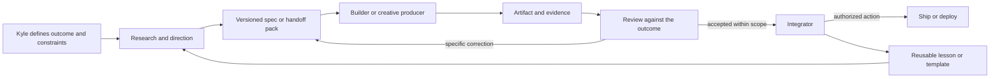

# 09 Reproducible collaboration

This is a proposed operating guide distilled from the project histories and [Codex's contribution](../contrib/codex.md). It connects research, creative work, implementation and review through artifacts another person can use. The historical accounts remain in 01–08 and `contrib/`; this guide generalizes their practices rather than inventing a new execution system.

The unit of progress is an accepted artifact with evidence: a spec, asset pack, patch or running feature. A useful conversation becomes portable when its decisions, inputs, checks and next action travel with that artifact.

## The complete loop

Review may happen before implementation, after a worker returns, or after Kyle tries the product. These are roles, not required separate agents. One person with one assistant can use the same loop. Existing publication and deployment gates still apply; see [06](06-rules-and-lessons.md).

## Start with the smallest useful packet

Copy [HANDOFF.md](../templates/HANDOFF.md) for a task. Keep one packet per independently reviewable outcome. A small task may fit in a dozen lines; a multi-worker feature needs contracts and file ownership. Record:

| Field | Why it travels |
|---|---|
| Outcome and acceptance | The next agent knows what the user should be able to do and how to prove it |
| Baseline | A repo commit, spec revision or asset hash prevents reviews of the wrong version |
| Decisions and authorization | The receiving agent can distinguish chosen direction, current scope and actions still awaiting approval |
| Inputs and ownership | The receiver can locate the materials and knows which files or interfaces it owns |
| Checks and limits | Tests, visual checks, cost caps and exclusions define an honest completion claim |
| Return format | The next review starts with files, evidence and unresolved questions rather than a success narrative |

Use stable links or a transferable archive. A path on one agent's machine is not a shared artifact. Public inputs can use commit-pinned repository links; private inputs need an authorized private transfer. Do not publish private context just to make it accessible to a worker.

## Six steps with explicit exits

| Step | Owner's job | Exit evidence |
|---|---|---|
| 1. Understand | Restate the outcome, read current sources, identify constraints and uncertainties | A brief with observable acceptance and source/version references |
| 2. Decide | Resolve consequential choices with Kyle; use reasonable defaults for routine details within scope | A selected direction, revision and decision record; superseded choices marked |
| 3. Package | Deliver the spec, inputs, ownership, checks and return instructions | The receiver can open every required input and restate the task without hidden chat context |
| 4. Produce | Build the agreed slice; preserve editable sources and record results | Patch or artifact plus [RETURN.md](../templates/RETURN.md) |
| 5. Review | Check acceptance against the actual artifact; reproduce consequential findings | Accept, request changes, or blocked, each tied to evidence and a revision |
| 6. Integrate and learn | Integrate within authorization; record the resulting revision and reusable lesson | Acceptance evidence on the integrated result; a small update to the relevant guide/template |

An accepted asset pack can finish at step 5 if Kyle only requested the pack. Integration, publication and deployment are separate outcomes. Continue authorized work without asking for the same permission again; verify the original scope before taking a newly gated action. A forwarded summary is context, not fresh authorization.

## Select the appropriate route

| Request | Apply the loop this way | Example |
|---|---|---|
| Research or spec | Compare options, preserve the intended experience, state unproven feasibility, hand off executable acceptance gates | Emurizz: true netplay and in-pane gameplay separately qualified |
| Code review or performance | Pin base/head, reproduce the issue, specify invariants and compare identical inputs | Doppler: precision, cache corruption, timing and accuracy |
| Creative assets | Offer alternatives when useful, preserve the selected reference, package sources/exports/preview and integration requirements | Comfyrizz brand pack; Terry animation pack |
| Product or demo review | Follow one complete user journey; separate real capture, illustration and edited narration | Comfyrizz film plus scoped retake; Hyperrizz delivery |
| Multi-worker feature | Freeze shared contracts, assign non-overlapping paths, run dependencies in waves, verify before integration | Existing bees workflow in [03](03-development-and-orchestration.md) |

The minimum setup is a repository or folder, a versioned handoff, the returned artifact and an evidence report. Orbit, bees, model choices, specific hosts and Google Colab are implementations of the workflow, not prerequisites for learning it. Use the current authorized tools and budgets rather than copying dated capacity limits from a case study.

## Evidence must match the claim

For code, the strongest form of this is the contract-first, test-first loop in [16](16-acdd-tdd.md): each acceptance criterion has an id and named tests, the tests fail first for the right reason (RED), pass after the change (GREEN), stay green after cleanup (REFACTOR) and on the combined branch (integration), and every result is recorded by the verifier, not the worker. A check that did not run is reported as not run.

| Evidence | It supports | It does not establish |
|---|---|---|
| Source inspection | A behavior visible in the inspected code | That the application ran successfully |
| Isolated reproduction | The tested failure or numerical property | Full application correctness or universal performance |
| Test/build result | The named checks on the named revision | Unexecuted paths, real-host behavior or visual quality |
| End-to-end exercise | The observed journey in the recorded environment | Every platform or deployment |
| Hash or archive check | File identity and transfer completeness | Runtime compatibility or perceived quality |
| Visual/playback/listening review | The inspected output and moments | Unviewed frames or unheard audio |

Label checks as **passed, failed, not run, or blocked**, with who ran them, the revision, environment and evidence location. Separate self-reported results from independently reproduced results. No test count compensates for an unmet product requirement.

Those labels apply to the practices as well as to the checks. [28](28-agent-lessons.md) grades each recurring lesson — **PROVEN** when a test, schema or CI job enforces it at a named place, **OBSERVED** when only a reported incident supports it, **RECOMMENDED** when it is reasoned but untested — so a handoff can carry the strength of its evidence, not just the evidence.

For benchmarks, keep input identity, settings, thread counts, cache state and measured scope with the numbers. Runtime, memory and quality are separate results. Keep tuning and held-out data separate according to the project's policy.

For media, deliver the exact reviewed encode, editable sources, provenance and technical checks. Use [ASSET-PACK.md](../templates/ASSET-PACK.md). A decoder can validate the file while a viewer still finds a broken arm or an unreadable scene.

## Handle corrections and interruptions

When Kyle changes a requirement, record the new decision and its source, mark the old one superseded, and update dependent briefs and checks before resuming affected work. Emurizz's streaming-to-netplay change affected architecture; its later player-count change affected acceptance and implementation. Neither belongs only in a chat summary. For code, the durable form of the rule is the frozen-contract supersession in [27](27-recovery-protocol.md), graded in [28](28-agent-lessons.md) L-19: a correction keeps the contract's identity and the failed attempt's evidence.

Before resuming interrupted work, inspect the artifact, last accepted revision and any active jobs. Continue the earliest incomplete step without duplicating a render or dispatch. Stop/hold instructions and budget limits carry through handoffs.

When a review fails, send the smallest actionable correction: observed behavior, expected behavior, reproduction, affected version and acceptance check. Preserve unaffected work. After a fix, revisit the finding and related claims; do not keep citing an obsolete result.

## Keep one authoritative copy

The project owns its current spec, code and product evidence. This repository owns the general method and dated case studies. Runtime-specific skills own detailed execution instructions. Link those sources instead of copying their full procedures into every brief.

Close a task with three questions: what decision mattered, what evidence caught a problem, and what instruction would prevent the next person repeating it? Promote the answer into a reusable rule only at its proper scope. A game's art policy, a tribute companion's quote policy and a film's narration policy are not interchangeable.

Use [10 Teaching the workflow](10-teaching-the-workflow.md) to practice the loop and test whether a handoff is actually reproducible. The [reference demo](../reference/README.md) is a complete miniature that runs offline. [12](12-three-layer-architecture.md) describes how this protocol sits above bundlebees and Orbit; [13](13-bundlebees-hardening.md) is the hardening now on bundlebees `main` (untagged). [15](15-agent-agnostic-and-orbit-start.md) is the intended first-run path (in progress). For changes to a live host, pair the loop with [11 Working together](11-working-together.md) and the [infrastructure deploy template](../templates/INFRA-DEPLOY.md).
