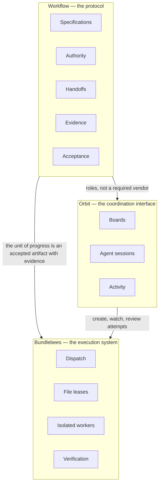

# 12 — Three-layer architecture

This repository describes a way of working that is larger than any one orchestrator, model or host. The useful split is three layers that can be replaced independently, as long as the acceptance and authorization contracts stay the same.

The same protocol can be carried out by Hermes, OpenCode, Codex, a Cursor cloud agent, a human, or another agent. Changing the worker or the board should not change what counts as an accepted result, who may merge or deploy, or how a handoff has to travel.

This chapter is a framing for the existing guides. It does not replace [09](09-reproducible-collaboration.md), [03](03-development-and-orchestration.md) or [11](11-working-together.md), and it does not claim that production collection or verifier hardening is finished.

## 1. Workflow — the protocol

The protocol is the set of rules that make work understandable, reviewable and reversible across people and tools:

| Element | What it fixes |
|---|---|
| Specifications | An outcome, baseline, chosen direction and observable acceptance travel with the work, not only in a chat |
| Authority | Execution can be delegated; merge, tag, release, deploy and similar gates cannot. Only Kyle's own words count, and a relayed yes is not approval. See [06](06-rules-and-lessons.md) |
| Handoffs | A receiver can start from a packet and the listed inputs, without reconstructing a hidden conversation. Use [HANDOFF.md](../templates/HANDOFF.md) |
| Evidence | A claim is only as strong as the check that produced it, tied to a revision. Self-reported worker results are not the same as independently reproduced results |
| Acceptance | The unit of progress is an accepted artifact with evidence, not an agent's claim that a task is finished |

[09](09-reproducible-collaboration.md) is the portable loop for this layer. [10](10-teaching-the-workflow.md) is the practice version. The [reference demo](../reference/README.md) is a runnable miniature that does not need this project's private infrastructure.

## 2. Bundlebees — the execution system

[bundlebees](https://github.com/mojomast/bundlebees) is one execution system that implements the protocol for leased coding work. Its job is to dispatch work, keep workers from colliding, and return evidence:

- **Dispatch.** A coordinator hands a self-contained brief to an isolated worker. The brief names the baseline (`source_rev`), the files the worker may touch and the acceptance checks.
- **File leases.** Ownership is recorded by the coordinator before dispatch. A worker cannot widen the lease by claiming extra files in its result. Parallel slices are possible because the leases do not overlap.
- **Isolated workers.** Each attempt runs in its own sandbox, starting from the named revision, without coordinator credentials.
- **Verification.** A verifier applies the patch in a throwaway environment, checks the baseline and the lease, runs the agreed tests, and returns only the evidence. Worker claims are self-reported until that happens.

The history of how bees were actually run — Cua sandboxes on Kyle's PC, `verify.sh` on the box, Orbit as the transport — is in [03](03-development-and-orchestration.md). That history is one implementation. The contracts are meant to stay usable if the sandbox, the model or the transport changes.

Hardening that verifier further (a disposable unprivileged environment with no coordinator credentials or network, exact `source_rev` comparison, a mandatory suite on the combined branch, and a production metrics log) is in progress in a separate bundlebees pull request. It is not done in the public plugin yet, and this chapter does not treat it as shipped.

## 3. Orbit — the coordination interface

[Orbit Desktop](https://github.com/mojomast/orbitdesktop) is the coordination interface used in this project: collaboration boards, agent sessions (Grok Bots, Hermes, Pi and others), and the ⚡ Activity view for live work and subagents. The local-workers adapter is how board tasks become launcher attempts.

Orbit is a convenience, not a prerequisite for the protocol. A handoff can be a markdown file and a git branch. Boards, sessions and activity should remain swappable so that a different desktop, a different agent runtime or a plain repository can sit in this layer without rewriting acceptance rules.

## 4. Measurement

These measures are the ones that would show whether more parallelism actually improves outcomes. They are listed here so they are not forgotten; they are **not collected in production yet**.

| Metric | Question it answers |
|---|---|
| Cost per accepted change | What did an accepted artifact cost, in the units the project actually tracks (time, compute, tokens or spend)? |
| First-pass verification rate | How often did a worker's result pass independent verification without a redispatch or human correction? |
| Human interventions | How many times did Kyle or another person have to step in before the artifact was accepted? |
| Plan-to-accepted time | How long from an approved plan to an accepted artifact? |
| Regression escapes | How often did a change that passed its slice checks fail later, in integration, on a real host, or after release? |
| Failed-worker recovery | When a worker failed or was rejected, was the work recovered, redispatched, or dropped, and how long did that take? |

The [reference demo](../reference/README.md) writes a JSONL summary with these fields so the schema can be inspected. Its "cost" is a synthetic unit of one per scripted worker, not currency or model spend, and the run is too small to be a baseline. Production instrumentation is part of the in-progress bundlebees hardening work, not something this repository already provides.

Chapter 10 already proposed related teaching measures (time to first useful artifact, missing-context questions, review findings, revision count, whether the receiver reproduced the check). Those also have no measured baseline yet.
