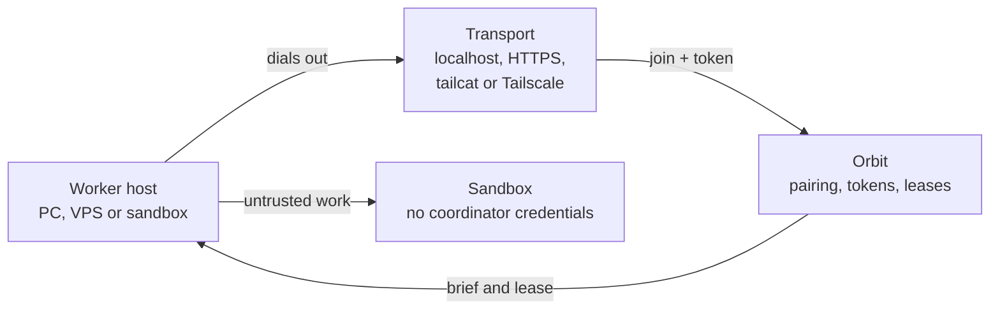

# 14 — Networking and worker deploy

How to deploy bundlebees workers against an Orbit coordinator in an agent-agnostic way, including what tailcat is and which network path should be the default.

Research as of 12 Nov 2026 (America/Toronto). This chapter is a guide plus a plan. **It does not change Orbit or bundlebees by itself**, and it does not name private hosts, tokens or tailnet addresses.

Kyle's current hosts and the historical Tailscale-only path are still in [05](05-infrastructure-hosting-networking.md). The worker contracts the plugin already enforces are in [13](13-bundlebees-hardening.md).

## Built versus planned

**Already true today**

- The application contract already lives in the coordinator: a brief, a signed lease, sandboxed verify, and a [WorkerBackend](13-bundlebees-hardening.md#6-workerbackend-adapter-contract) that is independent of the transport.
- When Orbit and the worker share a machine or a compose network, the default is loopback. bundlebees ships `orbit-loopback` as the default adapter; a configured `launcher` URL is an alternative.
- Kyle's own setup reaches the PC launcher over his tailnet. That is a power-user overlay that already works for him. It is not the product default for someone adopting this workflow.
- Workers in that setup already dial out to a known coordinator or launcher URL; they do not listen for inbound work.

**Planned — not shipped in Orbit or bundlebees**

- A coordinator-hosted relay as the documented product default: every worker dials out over HTTPS or a WebSocket (long-poll as a fallback) with a **one-time pairing code** (or QR), then a **short-lived scoped worker token**.
- **tailcat** as the default zero-account transport when both sides are behind NAT.
- **Cloudflare Tunnel** as the documented way to give a home-hosted Orbit a public join URL (worker-join and API endpoints only).
- A one-liner worker image and a join command that probes transports in a fixed order.
- An Orbit Workers list that can revoke a token immediately.
- Hosted Tailscale, Headscale or NetBird as optional overlays for people who already run a mesh — not as the first-run requirement.

The rest of this chapter describes that planned default, and why, so later implementation can follow it. Sentences about pairing codes, join QRs, scoped worker tokens, tailcat adapters, Cloudflare join URLs and the worker image are **planned** unless they explicitly say what already ships.

## Recommendation

**Default (planned).** Make the product contract a coordinator-hosted relay: every worker dials out to Orbit over HTTPS or a WebSocket (or long-poll) with a one-time pairing code or QR, then a short-lived scoped worker token. No inbound ports on the worker, and no coordinator credentials in the sandbox. When Orbit and the worker are on the same machine, that URL is localhost and no overlay is installed. That last part already matches today's loopback default.

**When both sides are behind NAT (planned).** Use tailcat as the default zero-account transport. It is a real, official Tailscale project: the open-source data plane (WireGuard, magicsock, DERP) with no Tailscale account, no root and no control plane. The tailcat address can travel inside the same QR as the pairing code. Speak the same worker protocol over the tunnel, so Tailscale, Headscale, Cloudflare Tunnel or a plain public URL are interchangeable fallbacks.

Do not make hosted Tailscale the default for people adopting this workflow. The Personal plan is non-commercial, it requires an account, and it ties the product to one vendor's control plane. Keep it, plus Headscale and NetBird, as a power-user overlay for people who already run a mesh or who want MagicDNS, tags and fleet ACLs.

## What tailcat is

tailcat is a real project, not a typo for Tailscale or a tailnet. It is Tailscale's official, BSD-3-Clause tool and Go library that behaves like netcat over Tailscale's data plane, without Tailscale's control plane. The repository is [github.com/tailscale/tailcat](https://github.com/tailscale/tailcat). It was written in 2023 as "derpcat", open-sourced on 31 August 2026 at the TailscaleUp conference, and described in Tailscale's blog post [Tailcat: Tailscale without Tailscale, by Tailscale](https://tailscale.com/blog/tailcat). The latest release at the time of this research is v0.7.0 (19 September 2026). The repo remains actively committed, with Windows, Android and library fixes landing after that tag.

| | |
|---|---|
| Open-sourced | August 2026 (TailscaleUp; written 2023 as derpcat) |
| Latest release (this research) | v0.7.0, 19 September 2026; later unreleased fixes exist |
| Licence | BSD-3-Clause, copyright Tailscale Inc. and contributors |
| Install cost | Userspace: no root, no TUN, no routing or DNS changes |

- **What it is not.** It is not a mesh VPN, not a Tailscale account substitute, and not Headscale. There are no users, ACLs, MagicDNS or device inventory. It is a point-to-point encrypted pipe.
- **How two sides meet.** The listener prints a `tc…` address: public keys, an optional pre-shared key, and DERP bootstrap, encoded for sharing out of band. Both sides meet on a DERP relay, complete a WireGuard handshake, then try a direct UDP path.
- **NAT traversal.** The same STUN and disco hole-punching as Tailscale. If a direct path fails, DERP relays the encrypted packets. Public tailcat DERP is rate-limited, has no SLA, and Tailscale may revoke access. You can run your own DERP and embed that relay in the address.
- **Security model.** By default the address is a bearer capability and keys are ephemeral (dead when the process exits). Saved keys stay reachable by anyone who ever saw the address, unless you pass `--allow` with client node keys. A WireGuard pre-shared key is on by default. DNS TXT publication is supported and is unsafe without `--allow` or SSH authorized keys.
- **Maturity caveats.** The README states there are no API, CLI or wire-format stability promises. SECURITY.md calls the wrapper early and experimental: the original threat model was the same person on both ends, not mutually untrusted parties. Treat it as production-grade transport only behind your own pairing and token layer, and pin a version if you embed the library.
- **Platforms.** CLI and library on Linux, macOS and Windows (Homebrew, Scoop, Snap, deb, rpm, conda-forge, containers, `go install`). An experimental browser WASM demo exists and is DERP-only until WebRTC lands. No root required on any of them.
- **Why it fits this workflow.** The blog's stated motivations include sandboxed agents, ephemeral VMs and wiring untrusted machines without touching system networking. That is the bundlebees worker problem. The address is already QR-friendly, and the Go library can sit under a WorkerBackend transport adapter.

If someone asked for "tailcat" and meant something else, the likely neighbours are a Tailscale tailnet, Tailscale Funnel (a way to publish a local port on a MagicDNS name), or Headscale. None of those are account-free. tailcat is the tool that actually matches "a default for users who do not have Tailscale."

## Fit for this workflow

| Option | Role | Why |
|---|---|---|
| Coordinator-hosted relay (HTTPS or WebSocket) | Default protocol **(planned)** | Workers always dial out to Orbit with a pairing code, then a scoped token. No inbound ports on the worker. This is the application contract, not just a network tool. |
| localhost / Docker network | First-run default **(built)** | When Orbit and workers share a machine or compose file, skip every overlay. This is how most newcomers should start, and it already matches the loopback adapter. |
| tailcat | Default NAT fallback **(planned)** | Official Tailscale data plane without an account, root, or control plane. Use it when Orbit is behind NAT and the worker is on another PC, a VPS or a sandbox. |
| Cloudflare Tunnel | Best way to publish Orbit **(planned as the documented path)** | If the coordinator needs a public URL, expose only the worker-join and API endpoints. Free, outbound-only, no mesh required. |
| Tailscale (hosted) | Power-user overlay | Best mesh if the user already has a tailnet. Use tagged, ephemeral auth keys or tsnet. Personal plan is non-commercial, so do not make it the product default. Kyle's current setup uses this; see [05](05-infrastructure-hosting-networking.md). |
| Headscale | Self-hosted Tailscale | Same clients and auth-key model, you run the control plane. Right choice when a user wants a mesh but no vendor account. |
| NetBird | Self-hosted mesh with a UI | Full open-source stack with SSO and a web console. Heavier than Headscale if they already use Tailscale clients. |
| ZeroTier | Not a default | Layer-2 virtual switch. Useful only if broadcast or non-IP traffic is required. Free tier is small; commercial self-host is restricted. |
| Plain WireGuard | Not a default | Excellent crypto, poor newcomer experience. No NAT traversal, key distribution or revocation UX of its own. |
| ngrok | Demos only | Fastest public URL for a trial, but free-tier quotas and a vendor dependency make it a poor default. |
| frp / rathole | Bring your own VPS | Fine if someone already runs a relay host. Easy to misconfigure (plaintext tokens, open ports). rathole's last stable release is from 2023. |
| iroh / libp2p | Future option | iroh is the cleaner P2P stack (dial by key, tickets, self-hosted relays). libp2p is heavier. Neither beats tailcat for this workflow today. |

Figures below are from vendor docs and project pages checked on 12 Nov 2026. Free-tier numbers change; re-check before shipping pricing copy. Mesh options give you a network. Tunnel and relay options give you a path to one coordinator. This workflow only needs the second thing, plus an optional overlay for people who already have one.

## Setup, NAT, cost and security

| Option | Setup friction | NAT traversal | Self-hostable? | Pairing and keys |
|---|---|---|---|---|
| Coordinator relay | Low, once Orbit is reachable | None on the worker: it dials out on 443. The hard part is making Orbit reachable if it is also behind NAT. | Yes: it is just Orbit | The pairing token is the credential |
| localhost | None | Not needed | Yes | Loopback only |
| tailcat | Low: share an address or QR, no account, no root, userspace only | Excellent: magicsock hole-punch, DERP bootstrap and relay fallback | Yes, including your own DERP; public Tailscale DERP is optional and rate-limited | Address is a bearer secret; `--allow` locks to client keys; PSK on by default |
| Cloudflare Tunnel | Low if the user has a domain on Cloudflare; quick tunnels need no domain | Outbound-only from Orbit; Cloudflare is the public edge | The edge is Cloudflare; cloudflared is Apache-2.0 | Access policies or service tokens in front; do not publish the whole UI |
| Tailscale | Low for people who already have it; account and client install for newcomers | Excellent: STUN, hole-punch, global DERP | Control plane is vendor-hosted; clients and DERP are open source | SSO, tags, ACLs, auth keys, device approval, key expiry |
| Headscale | Medium: run a control server, issue pre-auth keys, point official clients at it | Same as Tailscale; you host DERP or use public ones | Yes, BSD-3-Clause | Pre-auth keys and HuJSON ACLs; no polished admin UI by default |
| NetBird | Medium: compose the management, signal and relay stack, or use their cloud | Direct WireGuard when possible; self-hosted relay/WebSocket fallback | Yes; management/signal/relay are AGPL-3.0, client is BSD-3-Clause | OIDC, groups, device approval on paid tiers |
| ZeroTier | Low on the hosted controller; self-host is a licensing and ops question | Good, with root servers as relay | Controller self-host is source-available and non-commercial unless you pay Enterprise | Network rules; weaker identity story than Tailscale or NetBird |
| Plain WireGuard | High for remote, NATed workers: keys, endpoints, keepalives, a hub | None built in; needs a public endpoint, STUN/ICE or a hub | Yes, everywhere | Keys you distribute and rotate yourself |
| ngrok | Very low | Outbound agent to ngrok's edge | No | Traffic Policy, OAuth; free plan is tightly limited |
| frp | Medium: VPS, DNS, tokens, TLS you configure | Client dials out to your VPS; optional STCP/P2P mode | Yes, Apache-2.0, very actively maintained | Token auth; enable TLS or the token can travel in the clear |
| rathole | Medium, similar to frp, slimmer | Client dials out; Noise or TLS optional | Yes, Apache-2.0, but last stable is v0.5.0 (Oct 2023) | Per-service tokens |
| iroh | Low for a Rust app; tickets are shareable like tailcat addresses | Hole-punch plus relay fallback; public n0 relays are for dev and rate-limited | Yes, MIT or Apache-2.0 | Dial by public key; tickets are reusable, not one-time |
| libp2p | High: circuit relay, DCUtR, identify, more moving parts | DCUtR hole-punch with a stateful relay | Yes, MIT | Peer IDs and protocol muxing; you still design pairing and revocation |

| Option | Cost (Nov 2026) | Licence | Least privilege and revocation | Notes |
|---|---|---|---|---|
| Coordinator relay | Free; your hosting only | You own the code | One-time pairing code, then short-lived scoped worker tokens; revoke in Orbit | Best default: least privilege lives in the app, not the network |
| localhost | Free | N/A | No remote exposure | Right default when everything is on one box |
| tailcat | Free. Public DERP is rate-limited, no SLA, and can be withdrawn. Self-host DERP or pay Tailscale for a dedicated fleet. | BSD-3-Clause (Tailscale Inc.) | Address is a capability. Use ephemeral keys by default; `--allow` for stable keys; never publish no-auth services in DNS. | Young (open-sourced Aug 2026). No API or wire-format stability promise. Threat model was originally same-person both ends; hardening is in progress. |
| Cloudflare Tunnel | Free plan includes 1,000 tunnels and no published bandwidth cap. Access is a separate product on the same account. | cloudflared is Apache-2.0; the edge is a vendor | Access policies, service tokens, WAF and DDoS at the edge | Vendor sees metadata and, unless you add end-to-end app TLS, is on the path. Fine for publishing a join endpoint, not for moving secrets in the clear. |
| Tailscale | Personal: $0, non-commercial, 6 users, unlimited user devices, 50 tagged resources, 1,000 ephemeral minutes/month. Paid plans for commercial use. | Clients BSD-3-Clause on open platforms; control plane is proprietary | Auth keys (1–90 days, reusable, ephemeral, tagged, pre-approved). Node key expiry. Tags and ACLs for least privilege. tsnet can embed in a process with no root. | Best managed mesh. Do not bake a Personal-plan assumption into a product other people will run commercially. |
| Headscale | No licence fee; you pay for the host | BSD-3-Clause; v0.29.7 released 30 Oct 2026 | Pre-auth keys and Tailscale-compatible ACLs | You operate the coordination server and its availability. |
| NetBird | Cloud free: 5 users, 100 machines. Self-hosted Community is free with no device cap. Commercial self-host add-ons are paid. | Client BSD-3-Clause; management, signal and relay AGPL-3.0 | OIDC and group policies | AGPL on the server stack matters if you modify and offer it as a hosted service. |
| ZeroTier | Free: 10 devices, 1 network. Essential is paid. Commercial controller self-host is Enterprise. | MPL-2.0 core plus a source-available non-free controller | Network rules engine | Licence makes it a poor default for an open, redistributable workflow. |
| Plain WireGuard | Free | Kernel module is GPLv2; userspace ports vary (wireguard-go is MIT) | Static keys you must rotate and revoke by hand | Wrong layer for pairing and least-privilege worker tokens. |
| ngrok | Free: one-time $5 credit, 1 GB egress, 20k HTTP requests, 5k TCP connections, 3 endpoints, 1 user, interstitial on browser traffic. Paid from about $10/month. | Proprietary service | Traffic Policy, OAuth, mTLS on paid tiers | Fine for a weekend demo, not for shipping workers. |
| frp | VPS cost only | Apache-2.0; v0.72.0 released 4 Nov 2026 | Tokens; turn on TLS; prefer STCP so services are not internet-scannable | A common footgun is a public frps with a short token and no TLS. |
| rathole | VPS cost only | Apache-2.0; last stable v0.5.0, Oct 2023 | Per-service tokens; optional Noise/TLS | Quiet upstream is a maintenance risk if you default to it. |
| iroh | Free; public relays are rate-limited; dedicated relays are a paid n0 service | MIT or Apache-2.0 | Public keys and tickets (reusable, not single-use) | Strong library, less operational maturity than magicsock plus DERP for this exact job. |
| libp2p | Free | MIT | You design the capability model | Too much protocol surface for a worker join flow. |

## Why this default

1. **The unit of trust is a worker token, not a VPN membership.** A mesh makes every node a peer unless you write ACLs. A dial-out worker can only claim work, stream events and upload evidence. Revoking the token is enough, even if the tunnel is still up.
2. **Most first runs never leave the machine.** [Orbit as a starting point](15-agent-agnostic-and-orbit-start.md) means docker compose on one box. localhost should work with zero network setup. Overlays are a fallback, not a prerequisite.
3. **The hard case is two NATs, no account and no inbound ports.** That is exactly what tailcat was released to do. Cloudflare Tunnel is the better fit when only Orbit needs to be published. Hosted Tailscale is the better fit when the user already lives on a tailnet.
4. **Keep the worker protocol independent of the transport.** If tailcat's wire format changes, or public DERP is withdrawn, the WorkerBackend contract does not change. Swap the transport adapter: public URL, Cloudflare Tunnel, Tailscale or Headscale, or a self-hosted DERP.
5. **Be honest about tailcat's youth.** Ship it pinned, behind your pairing layer, with ephemeral keys by default, and document that serious relayed throughput wants a self-hosted DERP (or a reachable Orbit URL so DERP is not on the data path). Do not block first-run on Tailscale sales or a Personal-plan account.

## Worker deploy sketch (planned)

This is the intended join flow, not a command that works against today's Orbit.

1. **Orbit is already running.** The newcomer deployed Orbit with docker compose or npm, locally by default. On first run they either pasted an API key for a Pi agent or picked OpenCode on a free model. Nothing about workers requires Tailscale at this point. See [15](15-agent-agnostic-and-orbit-start.md); that first-run path is itself still in progress.
2. **Add a worker, from the Orbit UI.** Orbit mints a one-time pairing code (about 15 minutes, single use) and a QR. The payload is small JSON: a pairing code, an expiry, an Orbit URL if one is known, and a tailcat address if Orbit has started a userspace listener. No admin token is in the QR.
3. **One-liner on the worker machine.** A shape, for documentation only: `docker run --rm -it --name bb-worker ghcr.io/mojomast/bundlebees-worker:latest join --code XXXX-YYYY`. The operator can also pass `--orbit-url`, `--tailcat`, or `--ts-authkey` if they already know the transport. GPU workers add the NVIDIA Container Toolkit devices; Cua workers use the Windows sandbox backend instead of Docker. That image and command are **not published yet**.
4. **Join probes transports in order.** (1) `--orbit-url` or a reachable URL in the QR, over HTTPS. (2) localhost, if the worker is on the same host or compose network. (3) tailcat, using the address in the QR. (4) tsnet or the Tailscale client, only if a tagged auth key was provided. The worker then presents the pairing code and receives a scoped worker token plus a refresh endpoint.
5. **The worker stays dialed out.** It long-polls or holds a WebSocket, advertises capabilities (`os`, `arch`, `sandbox=docker|cua`, `gpu=nvidia|metal|none`), and waits for leased work. It never opens an inbound port. If the transport drops, it reconnects and resumes with the same token until expiry or revocation.

For a persistent worker, drop `--rm`, mount a volume for the token and logs, and run a systemd or compose unit. The image should be a supervisor, not a wide-open Docker socket: it talks to a sibling or nested sandbox runtime that cannot see the token file.

## Sandbox, contract and platforms

These rules should hold regardless of transport. The sandbox and contract rows already match [13](13-bundlebees-hardening.md). The platform and Cua notes describe how a future remote supervisor should behave.

- **Sandbox rule.** The supervisor holds the worker token. Each attempt runs in a disposable, unprivileged environment with no coordinator credentials, no worker token, no SSH keys and no overlay keys. Network in the sandbox is off or tightly allow-listed during verify. Only the patch and the evidence come back.
- **Hardening this must match.** Sandboxed verify, leases taken only from the coordinator's locked record (never from the worker's self-report), required `source_rev` and an exact baseline check, then a mandatory integration suite on the combined branch. A first-pass metrics log records cost, retries, human intervention and recovery.
- **WorkerBackend contract.** Networking is a transport under the contract, not a second API. The backend still exposes: create attempt, stream events, result manifest, cancel. `orbit-loopback` / local-docker is the reference backend anyone can run. Cua, a remote supervisor, or a cloud sandbox are other backends that speak the same messages once they have a token. Model and provider stay in config, not in the transport.
- **Linux.** First-class. Docker or Podman workers, kernel or userspace WireGuard if the user chose a mesh, NVIDIA Container Toolkit for GPU. tailcat and cloudflared run userspace with no root.
- **macOS.** Docker Desktop, Colima or OrbStack. tailcat via Homebrew or conda-forge (no root). GPU (Metal) generally does not pass through Docker; advertise `gpu=metal` only for a native or Cua-style backend, not the default container worker.
- **Windows.** Docker Desktop or a Cua sandbox (already used by the PC launcher). tailcat has official Windows zips and Scoop packages, and v0.7.0 fixed localhost serving on Windows. GPU via WSL2 or native NVIDIA. Prefer Cua when the task needs a real desktop and a disposable user session.
- **Cua notes.** Treat Cua as a WorkerBackend, not as a network path. The supervisor on the Windows host still dials Orbit (localhost, tailcat or Tailscale). The sandbox inside Cua should not receive the worker token or any overlay key material.
- **GPU workers.** Capabilities are advertised at join time so the coordinator can schedule only work that needs a GPU onto those workers. Do not put GPU credentials or cloud API keys in the sandbox either; the supervisor injects only what the brief allows.

## How to revoke a worker (planned)

1. **Revoke in Orbit (source of truth).** A Workers list action immediately invalidates the worker token, refuses new claim and refresh requests, and cancels in-flight attempts. This must work even if the worker is offline; the next reconnect fails closed.
2. **Tear down the transport, as a second layer.** tailcat: drop the client node key from `--allow`, or rotate the Orbit listener key (which invalidates the printed address). Prefer token revocation first so you do not have to rotate a published join address for one bad worker. Tailscale or Headscale: expire or delete the tagged node, and rotate the auth key if it was reusable. Cloudflare Access: revoke the service token. Mesh membership is backup, not the primary control.
3. **Rotate pairing material.** Pairing codes are already one-time and short-lived. If a QR was screenshotted, it should be useless after use or expiry. Saved tailcat server keys are the main long-lived secret; keep first-run on ephemeral keys, and treat a stable key like a production credential.
4. **Assume the sandbox was hostile.** Because the sandbox never had coordinator credentials, revocation does not require rotating Orbit admin keys. Do still discard that attempt's worktree and ignore any patch that did not pass the combined-branch suite.

**Implementation order (planned).** Build the dial-out pairing and token layer first, with localhost and a public Orbit URL. Add a tailcat transport adapter second, pinned to a release, with a documented self-hosted DERP option. Add Tailscale or Headscale auth-key join for people who already have a mesh. Treat Cloudflare Tunnel as the documented way to give a home-hosted Orbit a public join URL. Leave ZeroTier, ngrok, frp, rathole and libp2p out of the default path.

## Sources

| Source | URL |
|---|---|
| tailcat repository and README | https://github.com/tailscale/tailcat |
| Tailscale blog: Tailcat announcement, 31 Aug 2026 | https://tailscale.com/blog/tailcat |
| tailcat SECURITY.md (threat model and fixed issues) | https://github.com/tailscale/tailcat/blob/main/SECURITY.md |
| tailcat releases (v0.7.0, 19 Sep 2026) | https://github.com/tailscale/tailcat/releases |
| Default tailcat DERP map | https://tailcat.dev/derpmap.json |
| Tailscale Personal pricing | https://tailscale.com/pricing |
| Tailscale auth keys | https://tailscale.com/docs/features/access-control/auth-keys |
| Tailscale ephemeral nodes | https://tailscale.com/docs/features/ephemeral-nodes |
| tsnet | https://tailscale.com/docs/reference/tsnet-server-api |
| Headscale (BSD-3-Clause, v0.29.7 on 30 Oct 2026) | https://github.com/juanfont/headscale |
| NetBird | https://github.com/netbirdio/netbird |
| NetBird AGPL announcement | https://netbird.io/knowledge-hub/netbird-agpl-announcement |
| NetBird plans | https://docs.netbird.io/manage/settings/plans-and-billing |
| ZeroTier pricing | https://www.zerotier.com/pricing/ |
| Cloudflare Tunnel docs | https://developers.cloudflare.com/tunnel/ |
| Cloudflare account limits | https://developers.cloudflare.com/cloudflare-one/account-limits/ |
| ngrok pricing | https://ngrok.com/pricing |
| ngrok free-plan limits | https://ngrok.com/docs/pricing-limits/free-plan-limits |
| frp (Apache-2.0, v0.72.0 on 4 Nov 2026) | https://github.com/fatedier/frp |
| rathole (Apache-2.0, last stable v0.5.0, Oct 2023) | https://github.com/rathole-org/rathole |
| iroh | https://github.com/n0-computer/iroh |
| iroh NAT traversal | https://docs.iroh.computer/concepts/nat-traversal |
| iroh relays | https://docs.iroh.computer/concepts/relays |
| iroh tickets | https://docs.iroh.computer/concepts/tickets |
| libp2p DCUtR hole punching | https://docs.libp2p.io/concepts/nat/dcutr/ |
