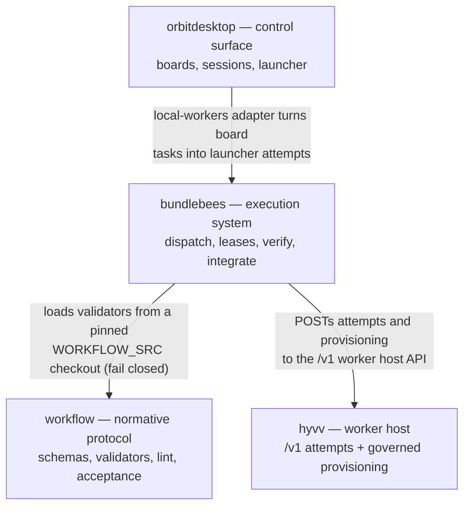

# Umbrella modularity — the dependency graph of the four elements

**Status (audited at workflow base `9f6aa6dc7a74890ef2284d7aa4432efc9b6a4169`, November 2026):** this
chapter maps what each element strictly requires, what it optionally integrates with, and the minimum
viable single-element install for each. It is an audit of what the code and the recorded pins actually
do, not a wish list. Install profiles that bundle these findings live in [`profiles/`](../profiles/repos.json),
one quickstart per profile under [`docs/quickstarts/`](quickstarts/contracts.md), and the index page is
[profiles.md](profiles.md).

**Method and its honest limits.** The evidence used here is what is checked into this repository:
the CI job manifests under `contrib/bee-ci/jobs/`, the recorded revision pins in the chapters, and the
module lists and endpoints those chapters record against the live trees (chapters 13, 22, 23, written
November 12–14, 2026). The hyvv, bundlebees and orbitdesktop repositories are **not checked out in this
workspace**, so every cross-repo module name, endpoint and pin below is cited to the chapter that
recorded it rather than re-verified here; `profiles/repos.json` carries those citations and the test
suite enforces that each pin string appears verbatim in its cited source. Commands quoted for the
single-element installs come from the checked-in manifests and chapters, not from memory.

## 1. The graph

Dependency points down and only down (chapter 22, §1): the protocol depends on nothing, the worker host
depends on nothing in the stack, the executor consumes protocol validators and the worker host API, and
the control surface consumes the executor. Two mechanical guards enforce the important half of that
direction on bundlebees `main`: `bundlebees_plugin/adapters.py` is the only module allowed to name an
agent, model or launcher, and the packets, recovery and return modules load their validators from a
pinned workflow checkout instead of re-implementing them — a missing checkout fails closed
(chapter 22, §1 and §2).

| Edge | Kind | Evidence |
|---|---|---|
| bundlebees → workflow | strict at runtime for the autonomy loop; CI requires it | `WORKFLOW_SRC` + `REQUIRE_WORKFLOW=1` in the mandatory suite; fail-closed validator loading (chapter 23, §4; chapter 22, §1) |
| bundlebees → hyvv | strict on the production dispatch path; CI requires the pinned source | `HYVV_SRC` + `REQUIRE_HYVV=1`; dispatch posts `POST /v1/attempts`; the two-feature factory test runs real hyvv HTTP (chapter 22, §7; chapter 23, §5) |
| orbitdesktop → bundlebees | optional integration at runtime | the `orbit-loopback` worker backend is the default, but a configured launcher URL or a scripted test backend replaces it (chapter 13, §6) |
| orbitdesktop → workflow | none at runtime | Orbit reads boards and artifacts; it does not load protocol validators (chapters 12, 17) |
| hyvv → anything in the stack | none | the host owns its filesystem and its API; the coordinator comes to it (chapter 19; chapter 22, §13) |
| workflow → anything in the stack | none | pure protocol: schemas, checkers and docs; the acceptance harness reaches out only when you run it |

## 2. Per-element audit

### 2.1 workflow (this repository)

- **Strictly requires:** Python 3.10+ (3.12 in CI) for the reference demo, lint and checkers;
  `jsonschema` for the schema checks; `pytest` for the contrib suites. Nothing else — no service, no
  network, no other element.
- **Optionally integrates:** docker or bubblewrap/firejail for the cold-start acceptance; gitleaks for
  the secret-scan leg; a bundlebees checkout for the acceptance harness to exercise the real verify
  path; an ACDD-capable bundlebees branch for the ACDD acceptance step.
- **Minimum viable single-element install:** clone, run the reference demo, the schema checks, the
  reference tests, the acdd-lint tests and the project-state checker. Commands are in
  [quickstarts/contracts.md](quickstarts/contracts.md), taken from `contrib/bee-ci/jobs/workflow.yaml`.
- **What it cannot do alone:** dispatch work, run a worker, or enforce a parked project — the
  project-state checker is advisory until an enforcing layer ships (chapter 18).

### 2.2 hyvv

- **Strictly requires:** a host it owns (its provisioning owns the host filesystem); `uv` and Python
  3.12 for its suites; `git` on the host for provisioning; gitleaks only for its scan leg.
- **Optionally integrates:** bundlebees as the dispatcher that calls `/v1/attempts`; the host-enrolled
  provisioning policy file that authorizes `POST /v1/provision/project` (chapter 22, §13).
- **Minimum viable single-element install:** clone, `uv sync`, run the unit suite and the contract
  suite, dry-run the installer. Commands are in [quickstarts/worker.md](quickstarts/worker.md), taken
  from `contrib/bee-ci/jobs/hyvv.yaml`.
- **What it cannot do alone:** dispatch, queue or accept work — something else must call the attempts
  API. Its governed provisioning endpoints live on the pinned `feat/worker-provisioning` branch (PR 4
  open at the audited revision), and its Windows path is unit-tested but never proven on a live Windows
  host (chapter 23, §3; chapter 24).

### 2.3 bundlebees

- **Strictly requires:** a pinned workflow checkout for the autonomy loop (packets, recovery and RETURN
  validation fail closed without it); the hyvv worker-host API on the production dispatch path; a
  sandbox backend (bubblewrap, then firejail) for verify — with neither, verify fails closed with
  `sandbox_unavailable` unless the explicitly unsafe local override is set; a coordinator-held HMAC key
  file at mode 0600; gitleaks in the verify path; git.
- **Optionally integrates:** Orbit as the launcher front-end for the default `orbit-loopback` backend; a
  configured launcher URL (`launcher` adapter); Hermes as the host process (a minimal host with the same
  `PluginContext` surface is enough — the acceptance harness proves that); OpenCode and Codex backends
  are documented fail-closed stubs.
- **Minimum viable single-element install:** clone all three of bundlebees, workflow and hyvv at the
  recorded revisions, export the four `*_SRC` / `REQUIRE_*` variables, run the mandatory suite. This is
  deliberately *not* single-repo: the CI pins both protocol checkouts by full SHA and refuses to run
  without them. Commands are in [quickstarts/orchestrator.md](quickstarts/orchestrator.md), from
  chapter 23, §4.
- **What it cannot do alone:** merge, push, tag, release or deploy (human-gated); claim exactly-once
  dispatch (the launcher has no server-side idempotency — adoption reconciles instead); enforce
  parked-project refusals (the hyvv gate is a proposal, chapter 18).

### 2.4 orbitdesktop

- **Strictly requires:** a desktop machine to run on. As a coordination surface it is self-contained:
  boards, sessions and the activity view work with no other element present.
- **Optionally integrates:** bundlebees through the local-workers adapter and the launcher API; agent
  runtimes (Grok Bots, Hermes, Pi, OpenCode) as adapters; the planned token router, SSH hosts and ACDD
  evidence view (chapter 17).
- **Minimum viable single-element install:** clone the repo and work from its own documentation. The
  dispatch manifest recorded here (`contrib/bee-ci/jobs/orbitdesktop.yaml`) declares the unit,
  browser-e2e and python-launcher legs with Python 3.12 and Node 22, but carries no commands — the
  runnable steps live in the orbitdesktop checkout, so this spec does not quote them.
- **What it cannot do alone:** create or verify attempts; prove work happened (a board status is never
  evidence that work completed). The one-command, runnable-by-anyone first run is **not landed** —
  `main` was reconciled with the live tree on November 12 (PR 24) and the follow-up is in progress
  (chapter 15). Do not hand a newcomer a `docker compose up` line for it as if it shipped.

## 3. Hidden-coupling gaps found during this audit

What breaks today if you use an element alone, and who owns the fix. Every row is verifiable against the
chapters cited.

| # | Gap | What breaks if you hit it alone | Fix owner | Evidence |
|---|---|---|---|---|
| G1 | bundlebees verify has no sandbox | verify fails closed (`sandbox_unavailable`) on any host without bubblewrap or firejail; the only escape is the labelled-unsafe override | bundlebees | chapter 13, §1 |
| G2 | bundlebees CI needs two foreign checkouts at exact SHAs | the mandatory suite cannot run from a bundlebees-only clone; a hyvv policy field added without bumping the pinned checkout produced a `TypeError` in the real-implementation tests | bundlebees (pin-bump process) | chapter 23, §4; chapter 28 (wrong-runner/pin lesson) |
| G3 | protocol validators load from a pinned checkout, not a package | running bundlebees without `WORKFLOW_SRC` kills packets, recovery and RETURN, not just CI | bundlebees (packaging decision) | chapter 22, §1 |
| G4 | two launcher protocols that are not the same | `poll.py` posts `{repo, pr, head_sha}` to `POST /dispatch`; `dispatch.py` posts a job-expanded item to `/v1/dispatch`; a poll item cannot be handed to manifest expansion unchanged | workflow (bee-ci shadow harness) | bee-ci README, poll/dispatch sections |
| G5 | poller's default repo list differs from the manifest list | running `poll.py` without `--repo` polls a different list whose items cannot be passed to `manifest.load_repo()` unchanged | workflow (bee-ci shadow harness) | bee-ci README, poll section |
| G6 | manifest declares capabilities the runner cannot satisfy | `acceptance-light` and `secret-scan` are marked bee-eligible but need docker sysctls / gitleaks downloads a bee cannot perform; declared Python, Node and browser versions are not installed by the runner | workflow (bee-ci) for the manifest; bundlebees for the image | bee-ci README, cold-start and manifest sections |
| G7 | the real-adapter acceptance path has never run | `ACCEPTANCE_ADAPTER=launcher` needs a launcher project mirroring the toy repo; the scripted worker is the only proven path | bundlebees + workflow (acceptance) | acceptance README, "does not prove" section |
| G8 | Orbit first-run is not runnable-by-anyone | a stranger cannot deploy Orbit with one command and start with a Pi key or a free OpenCode model; hermetic tests, vendor-neutral registry and onboarding are unlanded | orbitdesktop | chapter 15; chapter 17 |
| G9 | contract-aware verify is branch-only | `ACDD` dispatch/verify/integrate live on the bundlebees `feat/acdd-tdd` branch under review; from `main`, the ACDD acceptance step reports UNRUN (never passed) with the default setting | bundlebees | chapter 13 status table; chapter 16; acceptance README |
| G10 | hyvv provisioning is branch-only and Windows-unproven | `POST /v1/provision/*` exists at the pinned branch revision (PR 4 open), not on a merged mainline; the live Windows host has not run the path | hyvv | chapter 23, §3; chapter 24 |
| G11 | parked-project gate is a proposal everywhere | no layer (Orbit, board, hyvv, bundlebees) refuses a parked project today; the checker here is protocol-level only | hyvv (interface), bundlebees and orbitdesktop (consumers) | chapter 18, status box and §7 |
| G12 | the default worker model is hard-coded in the plugin | the default model remains `deepseek-v4.1-flash` in the brief path; agent-agnostic plumbing exists at the adapter seam but the default is still one vendor's model name | bundlebees | chapter 13, §2 |

## 4. Install profiles

The five profiles bundle the findings above into documented compose/config manifests under
[`profiles/`](../profiles/repos.json), each with exact components, env (names and sources only — values
are read from the environment at runtime, never written into a manifest), ports, auth posture and an
explicit cannot-do list:

| Profile | One-line meaning | Manifest | Quickstart |
|---|---|---|---|
| contracts | protocol only: author and check contracts offline | [profiles/contracts.json](../profiles/contracts.json) | [quickstarts/contracts.md](quickstarts/contracts.md) |
| full | all four elements at recorded revisions | [profiles/full.json](../profiles/full.json) | [quickstarts/full.md](quickstarts/full.md) |
| observer | watch only: Orbit with no execution system | [profiles/observer.json](../profiles/observer.json) | [quickstarts/observer.md](quickstarts/observer.md) |
| orchestrator | dispatch, verify, integrate: bundlebees plus its two pinned checkouts | [profiles/orchestrator.json](../profiles/orchestrator.json) | [quickstarts/orchestrator.md](quickstarts/orchestrator.md) |
| worker | serve attempts: hyvv alone on its host | [profiles/worker.json](../profiles/worker.json) | [quickstarts/worker.md](quickstarts/worker.md) |

`profiles/repos.json` is the shared element registry: URLs, roles, dependency edges and the recorded
revision pins with their citations.

## 5. Provenance

| Claim class | Source | Strength |
|---|---|---|
| Module lists, endpoints, fail-closed behaviours | chapters 13, 22, 23 (written against the live trees Nov 12–14) | recorded; not re-verified here (no element checkouts in this workspace) |
| CI legs, images, declared tool versions, hyvv and workflow commands | `contrib/bee-ci/jobs/*.yaml`, `.github/workflows/ci.yml` | checked into this repo; enforced by tests |
| Revision pins | `profiles/repos.json`, each pin string must appear in its cited chapter | enforced by tests |
| Gap list | the chapters cited per row | recorded |
