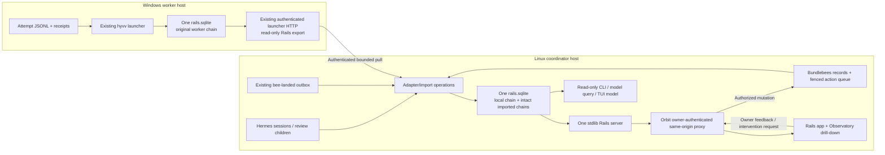

# Rizzstack Rails — implementation specification

Status: **draft for review, specification only**. Contract identifier reserved: `rizzstack.rails/1`. No implementation, deployment, acceptance, or interface freeze is implied by this PR. All commands and test names below are **proposed acceptance commands**, not executed product evidence. Dates: 2026-11-16.

## 1. Outcome, authority and readiness

Rails provides one reusable activity history for humans and orchestrators: inspect a job, attempt, campaign or session; understand agent/tool timing; locate verified acceptance evidence; record feedback; and request an authorized retry without changing history. The first acceptance slice is a real worker tool event reaching an Orbit rail and the same event appearing in a bounded agent query.

Owner constraints K1–K6: four existing repositories; standard-library-only new Python runtime; static JS/ES modules/SVG assets without a build; one new Rails server; one new SQLite ledger per machine; keyed durable append, read-only reads, RED-first package tests, independent review before merge and current-head CI. Existing job files, outboxes, Hermes databases and action queue remain authoritative and are reused, not replaced. SQLite WAL/SHM journals and consistent backup artifacts are physical companions, not extra logical databases.

D1: retain Linux coordinator and Windows launcher roles, but publish only aliases `coordinator-1` and `worker-1`. Private hostnames, endpoints and deployment paths stay in private configuration.
D2: Rails is an audit/observation system, never an authorization issuer or substitute verifier. A worker claim cannot become verified PASS because it appears in a hash chain.
D3: no automatic raw prompt, reasoning transcript, tool argument or tool-output ingestion. Safe structured summaries, explicit observable decisions and evidence references are the default.
D4: hash integrity uses SHA-256, not a signing key. Off-machine head checkpoints provide a limited independent anchor; this does not prove producer honesty or resist a privileged attacker rewriting all copies.
D5: use authenticated pull over the existing launcher connection for trace replication. Preserve existing landing delivery paths and protocol; neither a new worker service nor a new callback listener is introduced.
D6: proposed caps and latency targets below are defaults to validate in R00/M0; adjustment needs a recorded rationale and updated fixtures.

Readiness: implementation may begin with R00 feasibility/provenance and R01 contract fixtures. Consumers wait for reviewed contract freeze and the input artifacts specified in section 9. The real action-queue hook, installed Hermes schema, deployed Orbit proxy attachment and worker tool format are explicitly unresolved integration seams, not invented APIs.

The earlier roadmap calls F8 a snapshot collector. Tamper-evident Rails records are a new requirement here; do not silently relabel the original F8 or claim it delivered this ledger.

## 2. Source inspection and reuse

Read source at these pins; recheck changes at task admission:
- [vibeline](https://github.com/listeningpost/vibeline/tree/d5d0f425a64906ae1a50c1222314a5420da404d5), MIT, copyright 2026 ListeningPost. Inspected README, LICENSE, ledger.py, rails.py, web.py, sessions.py, swarm.py, shell.py, feedback.py and rewind.py.
- [workflow](https://github.com/mojomast/workflow/tree/9f6aa6dc7a74890ef2284d7aa4432efc9b6a4169): existing snapshot/1 is a closed schema; docs/06 prohibits private deployment details in Git.
- [bundlebees](https://github.com/mojomast/bundlebees/tree/b2db04b8c8463cef5cbf25a64dcaf2130edd142e): durable landing bridge, jobs and verification are input authorities. Action queue and doctor are user-reported in flight; no matching main-tree module was established in this inspection.
- [hyvv](https://github.com/mojomast/hyvv/tree/316bd975e212973837daeefc271a491471ea882c): launcher events are stored in attempt JSONL and exposed by events_since; landing_export.py exposes durable integer export positions.
- [Orbit](https://github.com/mojomast/orbitdesktop/tree/8530a14be7ce480ef35dd11890e72de4c89bed09): Observatory static app and extension guide exist. AGENTS.md requires real browser validation and tracked bundle parity when included code changes. The supplied deployed /obs-snapshot proxy was not located in server/index.mjs at this pin; R00 must locate its actual serving layer.

| Repo | Exact inspected revision |
|---|---|
| workflow | 9f6aa6dc7a74890ef2284d7aa4432efc9b6a4169 |
| bundlebees | b2db04b8c8463cef5cbf25a64dcaf2130edd142e |
| hyvv | 316bd975e212973837daeefc271a491471ea882c |
| orbitdesktop | 8530a14be7ce480ef35dd11890e72de4c89bed09 |
| vibeline | d5d0f425a64906ae1a50c1222314a5420da404d5 |

### Upstream compatibility decisions

| Upstream mechanism | Reuse | Required adaptation |
|---|---|---|
| ledger.py | Column names, canonical hash algorithm, verification vectors | Upstream is a reader, not a ledger writer. Its connect() uses a writable SQLite connection despite README wording. Rails reads must explicitly use mode=ro and query_only. No fallback to bundled example data in production. |
| rails.py | Lane geometry, markdown concepts, mark vocabulary | It infers children from prose and treats any historical AC pass as met. Rails uses explicit parent IDs and latest authoritative evidence bound to contract/revision; historical failures stay visible. |
| web.py + web/index.html | SVG interaction and inspector design, compatible presentation JSON where safe | Replace all routes/auth/storage hooks. No token in URL, no loopback auth bypass, no unbounded load_all, no local paths returned. Extract inline assets to catalog-safe static files. |
| sessions.py | Read-only Hermes session/message association and tool pairing | Incremental bounded reads, allowlisted sessions, explicit missing timing, output scrubbing, revision events when active/message state changes. Do not use full=True to export raw content. |
| swarm.py | Read-only parent/worker/reviewer topology | Optional source mode under Hermes adapter, same event schema; no second board or scheduling owner. |
| shell.py | Non-executing best-effort program classification | Classify in memory, retain only safe command-family labels. Never execute input or publish full command lines. Windows commands may be unknown until fixture coverage exists. |
| feedback.py | Ratings and export columns | Replace feedback.db and mutable rating rows with ledger feedback events; one write path. |
| rewind.py / spawn.py / peers.py | Ghost/retry UX concepts and machine namespace | Do not register direct rewind, terminal spawning or forwarding endpoints. Action queue owns authorized intervention; replication uses original chains, not arbitrary peer URLs. |

Vendor pristine upstream files and LICENSE with SHA-256 manifest under Orbit `contrib/vibeline/`; do not execute upstream server or install hooks. Bundlebees vendors only the needed pristine Python reader/classifier files from the same upstream pin under its own `contrib/vibeline/`. Document both manifests and local wrapper changes. Do not copy upstream executable behavior into privileged routes by default.

One shared stdlib runtime originates at `bundlebees/contrib/rizzstack_rails/`. Its versioned, hash-pinned source is copied into hyvv and Orbit `contrib/rizzstack_rails/` by a deterministic offline vendor script, not separately reimplemented or fetched at runtime. Contracts originate in workflow. This satisfies four-repo ownership without a fifth package repository or a runtime dependency on a checkout.

## 3. Architecture and reuse matrix



The Rails service owns serving and optional bounded adapter polling in the same process; polling invokes explicit ingestion operations. GET handlers never poll/import/write. The existing coordinator scheduler may invoke imports instead; configure exactly one import owner per source with a durable fence, not both. Worker emission runs inside the existing launcher process. One ledger per host contains multiple producer chains and imports. No broker, sidecar, feedback database or second scheduler.

| Mechanism | At least two concrete consumers |
|---|---|
| Canonical event + chain library | hyvv emitter; Bundlebees audit importer; Orbit query server |
| Source interface | Bundlebees file/outbox sources; Hermes reader; launcher replication |
| Lane/presentation projection | Orbit SVG; CLI markdown; TUI JSON |
| Shared query API | Hermes tool; minimal reference coordinator; Observatory |
| Cursor/checkpoint protocol | Windows replication; SSE reconnection; RETURN evidence export |
| Privacy filter | Every producer/importer; every query/export renderer |
| Latency calculation | Inspector heatmap; agent incident summaries |
| Feedback event reducer | Quality ratings; campaign intervention report; CSV/JSONL export |
| Fenced intervention handoff | Rails retry button; existing coordinator recovery workflow |
| Provenance/health report | Existing doctor integration; Observatory health/incident report |

No adapter executes jobs or makes approval decisions. Rails' checkpoint/cursor state lives in the same SQLite file. An action-queue transition and a ledger append are not assumed to be one atomic transaction: the authoritative queue transition must have a stable ID and replayable committed history/outbox. Reconciliation appends its audit event after the transition, retrying by key. A crash before audit publication yields visible lag, not a fictitious rollback of the actual action.

## 4. Frozen interface candidate: ledger and identity

The companion `schemas/rails/event.schema.json` is the draft machine envelope. R01 publishes closed kind payload schemas and vectors under this same directory, then freezes their canonical digest at a reviewed workflow revision. A consumer that does not recognize a version refuses it; no silent widening of /1.

### Identity and topology
- Persist random public machine alias and ledger UUID at initialization, never a hostname. Each original chain has immutable chain_id = machine alias + ledger UUID. Exactly one origin ordering per machine; imports keep their origin chain_id.
- Origin seq is contiguous from 1. event_id = chain_id + ":" + decimal seq. Global local arrival order is a separate ingest_seq used for pagination.
- dedupe_key is stable per source fact, unique within chain. Compare candidate digest excluding server-assigned event_id/seq/recorded_at on retry. Same key + same semantic bytes returns the original receipt; same key + different bytes is 409 idempotency_conflict. Do not invent a new key on retry.
- source = {adapter, instance, record_id, revision}. IDs use opaque public tokens; record_id must never be a raw filesystem path. Source identity and event bytes determine import deduplication.
- scope carries nullable repo slug, campaign_id, job_id, task_id, attempt_id, session_id, action_id, contract_sha256 and code_rev. At least one grouping ID is required. Omitted relationships stay unknown; no inference from near timestamps.
- lane_id identifies a producer/session/attempt, parent_lane_id and parent_event_id explicitly connect spawn. A missing parent renders an orphan placeholder. Parent cycles are refused; later parent discovery appends a link event, never changes old rows.
- fencing_epoch is a public nonnegative ordinal from the queue, not a bearer capability. Actual fencing secrets and authorization seals never enter Rails. Queue validates current ownership; Rails merely reports its observed decision.

### Event content and precedence
All events contain schema, chain identity/seq/hash, source, scope, lane and causal IDs, kind, occurred_at (nullable source UTC), recorded_at (writer UTC), duration_ms (nullable integer), timing_quality, authority, payload and redaction_policy.

Core kinds (closed for /1): lane.open, lane.spawn, lane.close, tool.start, tool.finish, decision.recorded, attempt.state, job.state, queue.transition, lease.recorded, verification.result, review.result, integration.result, merge.result, acceptance.result, usage.observed, feedback.recorded, intervention.requested, intervention.result, history.superseded, source.gap, source.checkpoint, source.error.

Payload rules frozen by R01:
- tool.*: call_id, tool_name, safe command_family, outcome pending|ok|failed|cancelled|unknown, summary, evidence_ref. Pair only by same origin/lane/call_id; never guess from adjacency. Interrupted start remains open/unknown.
- verification/acceptance: ac_id, contract hash, code revision, run_id, phase red|green|refactor|integration, verdict PASS|FAIL|NOT_RUN|BLOCKED|UNVERIFIED|EXPECTED_RED, evidence_refs and reason. PASS needs nonempty evidence; non-pass needs a reason. EXPECTED_RED requires frozen test intent, not a prose prefix.
- review.result: review_id, reviewer identity alias, author identity alias, reviewed head, verdict, independent boolean plus basis (distinct execution evidence, not a different display name).
- queue/lease/state: from_state, to_state, operation_id, fencing_epoch, code and safe evidence_ref. Exact leased file names are omitted by default; use digest + count; authorized relative path detail remains scrubbed.
- usage: usage_record_id, metric_scope, input/output/thinking tokens nullable, basis delta|cumulative|final, provider/model safe labels. Aggregate final receipt once per scope; use latest cumulative only when final absent; never sum both or infer cost from reasoning-event count. Existing usage ledger owns money calculations.
- feedback: target_event_id, rating -1|0|1|null, note <=2000 characters, category quality|intervention|both, actor alias supplied by trusted route, supersedes_event_id nullable. Unknown target refused.
- intervention.requested/result: request_id, target_event_id, operation retry|rewind_retry, queue_action_id nullable, decision pending|approved|declined|blocked|completed|failed, reason and authority_ref (opaque ID). Rating never grants action authority.
- history.superseded: old event IDs and replacement lane/event reference, authorized operation reference. UI ghosts old marks; ledger history remains intact.
- source.*: source identity, range/cursor, code, count and safe digest. A gap is explicit missing evidence, not an empty successful source.

Trust order: authenticated producer mapping determines authority (worker_report, coordinator_record, verifier_record, reviewer_record, owner_record, imported_observation); clients cannot self-label as owner/verifier. Existing record seal validation is retained and reported. Verified AC state is latest applicable verifier run at the selected contract AND revision, ordered by its source run order. Worker claims and transport completion never set it. A newer applicable failure invalidates prior current PASS; a different revision does not overwrite history. Product acceptance requires an owner record. A chain-valid event can still be unverified or unauthorized evidence.

### Canonical bytes and tamper evidence
Rails canonicalization C(x) = Python `json.dumps(x, sort_keys=True, separators=(",",":"), ensure_ascii=True, allow_nan=False).encode("ascii")`. Envelope values are strings, booleans, null, lists, objects and integers within ±(2^53−1); floats, duplicate JSON keys and lone Unicode surrogates are rejected. No Unicode normalization occurs. UTC timestamps use fixed `YYYY-MM-DDTHH:MM:SS.ffffffZ`; duration is measured monotonic time on one machine, never cross-host subtraction.

Rails hash = SHA256(b"rizzstack.rails/1\\n" + prev_hash.encode("ascii") + b"\\n" + C(envelope without hash)). prev_hash is "genesis" only for seq 1, otherwise 64 lowercase hex. event_id, seq, scope, payload and source are all committed. R01 supplies independently calculated positive/negative vectors, including Unicode, null, reorder, integer boundary and unexpected field cases.

For unmodified vibeline readers, expose an SQL VIEW named events with columns:
id, ts, task_id, actor, parent, kind, ac_id, result, why, tokens_in, tokens_out, sha, prev_hash, hash.
The underlying append table stores these compatibility fields AND the canonical Rails envelope. Compatibility why is deterministic C(envelope).decode("ascii"), so all extension fields are committed by the legacy hash too. Compatibility hash EXACTLY follows upstream: SHA256(prev.encode() + json.dumps({k: row.get(k) for k in _CHAIN_KEYS}, sort_keys=True, default=str).encode()); default separators/ensure_ascii must match upstream. Legacy prev starts "genesis" and chains in local ingest order. Store legacy fields at append, never regenerate them differently on read.

This makes upstream ledger verification usable without changing its algorithm. Renderers should use the safe Rails projection rather than show JSON why or rely on upstream AC/prose semantics. Do not claim unmodified upstream HTTP/UI is safe. The legacy hash checks local stored order; origin hash independently checks each imported stream. A filtered query is not a full-chain verification: report checked range and trusted head.

### SQLite transaction model
One DB with append-only event_rows (ingest_seq, envelope_json, compatibility columns), imported_origin_rows (original canonical bytes), and append-only import receipts/checkpoints. Mutable indexes/cursor projections and feedback reductions are rebuildable tables IN THE SAME DB. event_rows and origin rows reject UPDATE/DELETE via triggers. SQL views expose events and query projections.

Writers use BEGIN IMMEDIATE, busy_timeout=5000, WAL and synchronous=FULL on local disk; verify last head and dedupe before assigning seq. Commit precedes acknowledgment. Concurrent writers serialize through SQLite, not read-modify-write files. Rollback on partial batch, SQLITE_FULL or I/O error; do not acknowledge or advance cursor. Bounded retry three times with backoff then typed unavailable. No network-share SQLite on either host.

Import transaction verifies original bytes/hash/contiguous seq against the last imported head, inserts originals once and appends local source.checkpoint import receipt. Same origin seq with different hash => source_fork, halt that source. Out-of-order page => source_gap; request missing prefix, never splice or renumber. Every imported event is queryable by origin ID; do not count local receipt as a second copy of its activity.

Readers use URI mode=ro plus PRAGMA query_only=ON; no schema init, cursor advance, cache write, WAL checkpoint or network fetch in a read path. Read-only access to existing WAL shared-memory files is permitted; never immutable=1 on a live DB. Backup uses sqlite3 backup API and validates both chains in a disposable restored copy. No automatic pruning in /1. Disk pressure surfaces unhealthy and rejects appends; administrative backup/retention policy is separate and cannot silently discard chain history.

Source cursors advance atomically with all emitted records and source.checkpoint. Exported head checkpoints (chain_id, seq, hash) go into existing RETURN evidence and the peer's ledger, providing outside-the-origin anchors. An unanchored suffix, deleted suffix without known head, compromised producer, or privileged rewrite remains a stated limit. No hash/HMAC key custody is invented; token custody belongs to existing transport/owner authentication.

## 5. Source adapter contract and transport

Proposed Python interface (stdlib only), version `rizzstack.rails-source/1`:
```python
describe() -> dict  # adapter_id, version, source_instance, capabilities, supported_formats
read_batch(cursor: str | None, limit: int, byte_limit: int) -> dict
# {records: [Candidate], next_cursor, has_more, source_head, diagnostics}
health() -> dict  # live|stale|unavailable, last_success, safe error code
```
Candidates are validated envelopes without ledger-assigned chain/event/seq/hash/recorded_at fields; adapter supplies stable dedupe_key, source revision and normalized semantics. read_batch does not update source or ledger; importer commits and acknowledges its cursor in one transaction. limit<=500; batch<=1 MiB; record<=64 KiB. Partial trailing JSONL is retained for next poll, not skipped. Malformed complete rows generate source.error with opaque record ID/digest, never raw text; parser continues only if stable framing is established. Rotation uses source generation + byte offset, no inode-only identity on Windows. Replacement/shrink emits gap/new generation; no pretending continuity.

| Adapter | Source and stable identity | Special handling |
|---|---|---|
| bundlebees | jobs/attempts/verify-results/review/integration/merge committed records: record ID + semantic revision | Snapshot imports are observed states, not invented missing transitions. Validate available seals; action queue committed operation IDs take priority over duplicate snapshot observations. |
| launcher-log | Existing attempts/<id>.events.jsonl sequence + run generation; final receipt usage | Normalize worker:tool_call variants through fixture-versioned parsers. Native live emission and historical backfill use identical dedupe IDs. Unknown kinds yield safe opaque marks; no fabricated finish/duration. |
| Hermes-session | Allowlisted session and message IDs + semantic revision digest | Read existing state.db mode=ro. Preserve parent_session_id; read active-state changes as supersession events. Missing tables/columns => unsupported_source_version. Optional swarm input reads existing kanban databases only. |
| outbox | Canonical bee-landed ID + digest | Map terminal observation once, correlate existing attempt lane. Landing remains distinct from verification. Same attempt terminal received from log and outbox is two provenance observations of one state, not two completions. |

Windows: hyvv embeds the shared ledger writer and log adapter; no Hermes install there. Existing launcher HTTP adds authenticated read-only `GET /v1/rails/events?after=<origin-seq>&limit=N` and `GET /v1/rails/head`; response carries original envelope bytes, head and next cursor. Use the existing pinned/authenticated launcher transport and coordinator allowlist, no user URL parameters, no redirects. Reads do not backfill; launcher startup/maintenance ingestion performs replay before export marks source complete. Origin availability and recording health are separately reported.

Coordinator: importer uses this export, not remote filesystem mounts or worker SQLite access. Reuse existing landing outbox ingestion for terminal facts; do not change bee-landed/1 to carry arbitrary tool traces. If the launcher is disconnected, retain last good data marked stale, retry boundedly, and catch up from the last committed cursor. No lost records on disconnect between commit and response.

Emission failures: execution state remains owned by launcher/queue. Durable source logs permit backfill; recording health reports degraded. An acceptance report requiring complete Rails evidence stays BLOCKED until gaps recover. Sources without durable replay must not claim lossless delivery; R00 identifies them before M1.

## 6. Queries, rendering and privacy

Shared query `rizzstack.rails-query/1`:
```json
{"schema":"rizzstack.rails-query/1","selector":{"kind":"attempt","id":"att_example"},
 "format":"markdown","after":null,"limit":100,"max_bytes":32768,
 "include":["tools","verification","review","feedback"],"show_tokens":false}
```
selector kind: attempt|job|campaign|session|event; exactly one selector, public opaque ID. No SQL, arbitrary path, raw URL, regex or database parameter. JSON response:
```json
{"schema":"rizzstack.rails-result/1","ok":true,"items":[],"markdown":"",
 "next_cursor":null,"has_more":false,"truncated":false,
 "completeness":"partial","missing_sources":["launcher-log"],
 "integrity":{"status":"unchecked","checked_through":null},"warnings":[]}
```
Fields above are required; format=json returns items and empty markdown; format=markdown returns bounded markdown plus compact evidence identifiers in items. Max 500 items, 128 KiB HTTP, 32 KiB model result; limit 100/default. Emit a complete UTF-8 response including pagination metadata within cap, do not slice JSON or silently hide truncation. Cursor is opaque encoded (ledger UUID, snapshot ingest high-water, last ingest seq, normalized filter digest); input validated, cannot widen access. Page through a stable high-water while SSE supplies newer records. IDs/cursors are not capabilities; every call checks access. Missing selector => not_found; no history => empty with completeness status, never sample data.

Hermes tool proposed name `bundlebees_rails` delegates to this query with read-only credential/config scope. The standalone entrypoint `python -m rizzstack_rails query --kind attempt --id att_example --format markdown` uses the same projection; minimal reference coordinator imports query(request, reader) without Hermes. CLI packaging must expose the shared runtime module through the existing vendor loader; never require a manually edited PYTHONPATH. CLI exit 0 successful incl. partial with explicit status; 2 validation; 3 unavailable; 4 integrity failure. stdout contains only result, diagnostics scrubbed on stderr. Optional TUI consumes presentation JSON; no new Ink dependency is required on the Python runtime.

Projection `rizzstack.rails-view/1` preserves upstream parents/subs/events shape plus explicit lane tree, source status, evidence and timing quality. It pages or aggregates at overview scale; opening a mark retrieves its safe detail by ID. Do not fabricate origin events for visual grouping. Deep child trees remain navigable through breadcrumbs and focus.

Latency: tool duration is paired call start/finish monotonic duration when provided; timestamp-derived timing is labeled estimated. Model wait is separately labeled an observed gap, never inference tokens. Heatmap auto baseline is median of completed, non-ghost, comparable command_family + provider/model + environment fingerprint, within the selected view; >=5 samples, else insufficient_baseline. Slow means duration>=2000ms AND >3×median; fixed thresholds are an explicit UI option. Failures stay failures regardless of speed. Unknown durations stay unknown. No mixing pytest with ls; non-executing shell classification from upstream supplies safe labels.

Privacy invariant R-PRIV: scrub and allowlist before canonical storage, then scrub again at render/export. Do not hash unsanitized low-entropy secrets as public evidence. Retain safe source record references, not raw transcript digests by default. Omit arguments/results, env values, credentials, private URLs/IPs/hostnames, absolute paths and reasoning text. Keep tool name, safe program family, phase/outcome, timing and selected evidence IDs. Safe summary <=1000 characters; ambiguous unstructured content becomes [redacted], not a regex-only promise of secrecy. Free-text human notes go through the same policy; return a sanitized preview before submission. Logs/errors never echo request bodies or bearer values. JSON/HTML/Markdown escaping, terminal-control stripping and CSV formula neutralization are required. Query results are untrusted source observations, never instructions to an agent.

Evidence lookup is through an existing authorized artifact resolver using opaque refs and exact code/contract identity. Rails does not become a raw artifact download proxy. Review and RETURN use anchored IDs/hashes/ranges with completeness and redaction-policy version.

## 7. HTTP, SSE and authorized feedback

Rails server lives in Orbit `contrib/rails_server/`, Python stdlib ThreadingHTTPServer with bounded connections. Bind only configured numeric loopback. Require bearer auth on EVERY route (including health); reject unexpected Host, query-string tokens, redirects and cross-origin calls. Read credential and mutation credential are distinct existing-secret-store entries, never printed. Append authentication maps to producer/source scope; a reader cannot append or fabricate owner records.

| Route | Behavior |
|---|---|
| GET /v1/health | Revisions, schema digest, last import, integrity range, source status, clock/coverage warnings; no private paths |
| GET /v1/events | Validated selector/cursor query, read-only |
| GET /v1/view | Safe presentation JSON for same selector/cursor |
| GET /v1/stream | Authorized SSE with selector and Last-Event-ID; no ingestion side effect |
| GET /v1/feedback/export?format=csv|jsonl | Same authorized filter, paginated bounded feedback/intervention projection |
| POST /v1/append | Producer-authenticated atomic candidate batch; not exposed through browser proxy |
| POST /v1/feedback | Trusted Orbit owner route only; fixed feedback schema and idempotency key |
| POST /v1/interventions | Trusted authorized action submission; delegates queue, never executes shell/session mutation in server |

Error envelope {ok:false,error:{code,retryable,request_id}} with 400 invalid_request, 401 auth_required, 403 forbidden, 404 not_found, 409 conflict/source_fork/stale_fence, 413 too_large, 429 capacity, 503 source_unavailable/storage_full. No traceback/path leak. Requests require bounded Content-Length, application/json, UTF-8; reject chunked upload and invalid/negative length. Proposed request cap 1 MiB; feedback cap 8 KiB. Reverse proxy enforces timeouts and connection caps too.

Orbit same-origin routes `/api/rizzstack/rails/*` are proposed stable paths, attached to the verified existing owner API/proxy layer in R00. Backend destination is a fixed loopback configuration; never accept URL from browser. Inject bearer server-side; never localStorage/query URLs. Do not rely on tailnet reachability as authentication. Browser uses established authenticated fetch; mutations require existing owner principal plus CSRF/origin protection. The generated catalog pane is not itself an owner credential: if owner mutation capability cannot be safely delegated, feedback opens a trusted Orbit shell dialog and the pane stays read-only. Reuse this mediation for feedback and retry.

SSE uses authenticated fetch streaming if EventSource cannot convey existing auth. IDs = local ingest_seq cursor with ledger UUID/filter binding, payload = sanitized append/invalidation marks. Replay after Last-Event-ID, at least once; clients dedupe origin event ID/revision. Heartbeat comment every 15s; reconnect exponential 1..30s jitter. Limit 8 streams per server and 1 MiB buffer per stream, drop slow clients with reconnect instructions, never block writers. Unexpected cursor/ledger replacement returns 409 reset_required and refetches bounded snapshot; no data loss hidden. Stream auth expires/revalidates with session policy. Client fallback polls after cursor every 5s while visible, 30s when hidden; resume refetches. Tests include proxy buffering, expiration and restart, not just direct server SSE.

Feedback is append-only; editing/clearing appends supersedes_event_id. Compare expected previous rating revision; stale concurrent edit =>409. UI can keep user draft for retry. Same idempotency key returns original result, never duplicates intervention counts. Quality report reduces latest owner feedback by target; audit export preserves revisions. Only category intervention/both is included in intervention counts, never every thumb vote. Tool-wide flags are feedback targets of type tool_group plus bounded selector, not a second mutable table.

Retry/rewind is a two-stage trusted preview then authorized queue action. Preview names target, scope, budget and expected fence/revision; change invalidates it. Execution owner revalidates at claim and commit, using existing idempotency and fencing. If queue lacks this interface, mutation returns capability_unavailable and its task is blocked; read-only rails still ships. Rewind uses the existing supported Hermes operation under that owner, never direct SQL in Rails. It does not roll back files or external side effects. Record operation result before ghosting; uncertainty stays pending/reconcile, never blind replay. New attempt branches from the causal request; prior marks remain accessible. Rails reads never trigger a retry.

## 8. UX and acceptance milestones

Dark static catalog app: left lane tree, central SVG time axis with bounded marks, right inspector; overview shows timing/coverage/chain status. Zoom around cursor, pan, fit/reset, keyboard mark navigation and equivalent table view. Reduced motion removes pulses; color is accompanied by labels/icons. Focus returns to originating Observatory row on close. Empty, loading, partial, stale, unauthorized, disconnected and integrity-failed states have distinct text. A worker failure, expected RED, unrun check and human acceptance are visually distinct.

Observatory links use existing attempt_id/job_id in snapshot/1 to open a same-origin Rails route or catalog pane; no new fields in the frozen closed snapshot schema. A missing ID disables link with explanation. If later health additions cannot fit existing contract, propose snapshot/2 separately; do not add unvalidated fields to /1. Rails source health is initially queried independently by the drill-down and doctor.

| Milestone | Outcome and required evidence |
|---|---|
| M0 | Schema freeze + source fixtures + provenance + auth/queue attachment decision; no production claim |
| M1a | Worker fixture/native log -> worker ledger -> existing HTTP -> coordinator import -> actual Orbit proxy -> rail AND same CLI query, exact event identity; earliest integrated vertical slice |
| M1 | One bounded real coding campaign: dispatch, child tool calls, RED/GREEN, reviewer, integration, one human feedback, RETURN evidence; disconnect and coordinator restart with no duplicate events/actions |
| M2 | Full source coverage, viewport/heatmap/ghost feedback/export, safe retry request flow, bounded performance and independent audit |
| Activation | Stage inspected revision, owner-approved service/config/proxy activation, doctor parity + real browser check; published/loaded revisions independently recorded |

M1 RETURN gains a companion evidence file `rails-evidence.json` (schema rizzstack.rails-evidence/1) referenced through the existing RETURN evidence mechanism: machine aliases, ledger UUIDs, origin head ranges/hashes, imported checkpoints, source coverage/gaps, selected event IDs, code/contract revisions, redaction version, intervention count and actual verification links. If RETURN's frozen shape lacks a suitable evidence slot, use a documented sidecar linked from the campaign handoff and propose versioned change before modifying RETURN. receiver_decision stays pending. Hashes prove integrity relative to anchors, never completion by themselves.

Performance proposed acceptance workload: 10 concurrent lanes, 100k total events in local SSD SQLite, 500-row pages and max 2k visible marks. Warm query p95<=500ms across 100 queries on recorded coordinator hardware; live append-to-visible p95<=3s without disconnection; no unbounded memory growth in a 30-minute stream/reconnect run. Record memory, dataset, hardware and result; R00 may revise these defaults with evidence before freeze. UI aggregates overview and paginates drill-down; no load_all on large ledger. Clock skew, partial source and disconnected machine do not disappear from metrics.

## 9. Parallel execution packets

All paths below are **proposed leases** unless listed in source inspection. At admission, resolve existing in-flight paths to exact files and freeze a lease manifest; never allow a wildcard into unreviewed code. `[x,y]` means the two explicitly listed files, not a directory lease. Context for every packet: this spec, frozen schemas/examples, its upstream dependencies' handoff, owning repo instructions. Shared contracts have one owner R01; shared runtime one owner R02; existing entrypoint files one owner R17. No implementation bee can edit approved test expectations to make itself pass.

Every package first commits its listed tests/fixtures RED against its base for the stated missing behavior, then implements. For docs/vendor tasks RED is missing provenance/parity, not an unrelated runtime test. Handoff records test-first revision, GREEN head, commands/environment, contract digest, changed paths, unresolved findings and independent review. Commands execute from repo root with Python 3.10+ (Windows uses py -3.12 if needed); stdlib unittest for new runtime, Node built-in test for JS. Product fixtures are synthetic and secret-free. Existing required repo CI still runs. Test names are package-owned files and explicitly proposed.

| ID / size | Owning repo and exact file lease | Depends on passed artifact | RED-first acceptance; command | Milestone / consumers |
|---|---|---|---|---|
| R00 / S | workflow: specs/rails-feasibility.md; schemas/rails/fixtures/source-matrix.json; tests/test_rails_feasibility.py | none | Pin real source versions, record sanitized native trace and session shape, locate proxy/auth/queue hooks, resolve uncertainties Q1–Q4. Missing fixture/version/attachment makes the feasibility test RED. python -m unittest discover -s tests -p test_rails_feasibility.py; review rejects guessed hooks. | M0; all source authors + integrator |
| R01 / M | workflow: schemas/rails/event.schema.json; schemas/rails/source.schema.json; schemas/rails/query.schema.json; schemas/rails/view.schema.json; schemas/rails/http.schema.json; schemas/rails/payload.schema.json; schemas/rails/evidence.schema.json; schemas/rails/examples.json; schemas/rails/fixtures/hash-vectors.json; schemas/rails/README.md; tests/test_rails_contract.py | R00 inputs; this draft | Bad hashes/duplicate keys/kind payloads/PASS without evidence fail; legacy vector matches upstream; freeze digest. python -m unittest discover -s tests -p test_rails_contract.py | M0; every producer + consumer |
| R02 / M | bundlebees: contrib/rizzstack_rails/__init__.py; contrib/rizzstack_rails/ledger.py; contrib/rizzstack_rails/contracts.py; contrib/rizzstack_rails/privacy.py; contrib/rizzstack_rails/vendor-manifest.json; scripts/vendor_rails.py; tests/test_rails_ledger.py | R01 freeze | Concurrent 10 writers, identical/conflicting retry, crash around commit, mutation/hash detection, full disk, backup restore, readonly missing DB refusal and planted sensitive data. python -m unittest discover -s tests -p test_rails_ledger.py | M1a; hyvv + Orbit + Bundlebees |
| R03 / S | orbitdesktop: contrib/vibeline/README.md; contrib/vibeline/LICENSE; contrib/vibeline/ledger.py; contrib/vibeline/rails.py; contrib/vibeline/web.py; contrib/vibeline/sessions.py; contrib/vibeline/swarm.py; contrib/vibeline/shell.py; contrib/vibeline/feedback.py; contrib/vibeline/rewind.py; contrib/vibeline/web/index.html; contrib/vibeline/PROVENANCE.json; tests/test_rails_vendor.py | R01 | Exact pristine pin + license/digests; no startup hooks executed; node-independent assets inspectable. python -m unittest discover -s tests -p test_rails_vendor.py | M0; UI + compatibility reviewer |
| R04 / S | bundlebees: contrib/rizzstack_rails/source.py; contrib/rizzstack_rails/importer.py; tests/test_rails_importer.py | R02 | Append+cursor atomic, restart replay, fork/gap handling, truncated lines and byte caps; reads cannot commit. python -m unittest discover -s tests -p test_rails_importer.py | M1a; local sources + remote import |
| R05 / S | bundlebees: bundlebees_plugin/rails_bundlebees_source.py; tests/test_rails_bundlebees_source.py | R01,R04 | Committed verify/review/merge records map correctly; unsigned worker PASS stays claim; snapshots do not invent transitions. python -m unittest discover -s tests -p test_rails_bundlebees_source.py | M1; query + audit |
| R06 / S | bundlebees: bundlebees_plugin/rails_outbox_source.py; tests/test_rails_outbox_source.py | R01,R04 | Replayed landing dedupes; contradictory digest fails; terminal is not accepted. python -m unittest discover -s tests -p test_rails_outbox_source.py | M1; campaign + rail |
| R07 / M | bundlebees: contrib/vibeline/LICENSE; contrib/vibeline/paths.py; contrib/vibeline/sessions.py; contrib/vibeline/swarm.py; contrib/vibeline/shell.py; contrib/vibeline/PROVENANCE.json; bundlebees_plugin/rails_hermes_source.py; tests/test_rails_hermes_source.py | R01,R04,R00 supported Hermes fixture | Allowlisted sessions, nested reviewer topology, edits/ghosts, missing result, unsupported schema; source DB bytes unchanged. python -m unittest discover -s tests -p test_rails_hermes_source.py | M1; coordinator self-view + review rails |
| R08 / M | hyvv: rails_emitter.py; rails_log_source.py; rails_export.py; tests/test_rails_emission.py | R01,R02,R00 native-log fixture | Windows JSONL Unicode/rotation/partial rows, native/backfill dedupe, real local HTTP export fork/disconnect, observed usage unknowns. python -m unittest discover -s tests -p test_rails_emission.py | M1a; worker debug + coordinator |
| R09 / S | bundlebees: bundlebees_plugin/rails_remote_source.py; tests/test_rails_remote_source.py | R04,R08 export contract | No redirects/arbitrary URL, preserved origin bytes, loss after commit replay, export gap, stale host. python -m unittest discover -s tests -p test_rails_remote_source.py | M1a; peer view + forensics |
| R10 / M | bundlebees: contrib/rizzstack_rails/query.py; contrib/rizzstack_rails/projection.py; contrib/rizzstack_rails/markdown.py; contrib/rizzstack_rails/shell_labels.py; contrib/rizzstack_rails/__main__.py; tests/test_rails_query.py | R02,R01 view freeze | Scoped bounded pages, cross-contract PASS rejection, latest failure, orphan/cycle, timing baselines, usage no double count, markdown injection. python -m unittest discover -s tests -p test_rails_query.py | M1a; Orbit + CLI + agents |
| R11 / S | bundlebees: contrib/rizzstack_rails/feedback.py; contrib/rizzstack_rails/export.py; tests/test_rails_feedback.py | R02,R10 | Retry duplicate, stale edit, target missing, clearing preserves history, intervention count distinct, CSV formula injection. python -m unittest discover -s tests -p test_rails_feedback.py | M1; quality report + intervention export |
| R12 / M | orbitdesktop: contrib/rails_server/__init__.py; contrib/rails_server/__main__.py; contrib/rails_server/http.py; contrib/rails_server/stream.py; tests/test_rails_http.py | R10,R11,R04 | Real HTTP unauthenticated loopback refused; size/Host checks, readonly GET, SSE reconnect/auth expiry/cap, no browser append. python -m unittest discover -s tests -p test_rails_http.py | M1a; proxy + machine query |
| R13 / M | orbitdesktop: apps/rizzstack-rails/index.html; apps/rizzstack-rails/app.js; apps/rizzstack-rails/rails.js; apps/rizzstack-rails/styles.css; apps/rizzstack-rails/inspector.js; tests/rails-ui.test.mjs | R01 view fixture,R03 | Parent/child rails, zoom/pan, ghost/failure/RED distinct, unknown values, keyboard/reduced motion, bounded marks, XSS-safe rendering. node --test tests/rails-ui.test.mjs | M1a; Observatory + standalone catalog pane |
| R14 / S | bundlebees: bundlebees_plugin/rails_tool.py; bundlebees_plugin/rails_cli.py; contrib/reference_coordinator/rails_query_example.py; tests/test_rails_consumers.py | R10 | Real shared query returns identical IDs via tool/CLI/reference consumer; no arbitrary path or raw prompt fields, caps and typed errors. python -m unittest discover -s tests -p test_rails_consumers.py | M1a; Hermes + reference coordinator |
| R15 / M | bundlebees: bundlebees_plugin/rails_actions.py; bundlebees_plugin/rails_queue_source.py; tests/test_rails_actions.py | R00 queue contract,R05,R11 | Existing real queue seam: stale fence, duplicate click, revoked authority, crash after accepted request, non-idempotent unknown state held; ghost only after success. python -m unittest discover -s tests -p test_rails_actions.py | M2; owner retry + recovery |
| R16 / S | orbitdesktop: server/rails-proxy.mjs; tests/rails-proxy.test.mjs; apps/rizzstack-rails/feedback.js; tests/rails-feedback.test.mjs | R12,R15,R00 auth attachment | Trusted owner dialog; no pane credential leakage; read vs write scope; CSRF, expired session, SSE buffering/reconnect and rollback of optimistic state. node --test tests/rails-proxy.test.mjs tests/rails-feedback.test.mjs | M2; feedback + retry |
| R17A / S | workflow: exact integration lease below | R01,R10 | Missing or wrong interface/evidence links fail contract checks. python -m unittest discover -s tests -p test_rails_contract.py | M1a; operators + RETURN |
| R17B / M | bundlebees: exact integration lease below | R05–R10,R14; R15 for actions | Registered CLI/tool/doctor use real configured query; source cursors survive restart. python -m unittest discover -s tests -p test_rails_registered.py | M1a/M2; Hermes + reference operator |
| R17C / S | hyvv: exact integration lease below | R08,R02 | Actual launcher records/exports fixture tool sequence on Windows without another service. python -m unittest discover -s tests -p test_rails_native.py | M1a; worker + coordinator |
| R17D / M | orbitdesktop: exact integration lease below | R03,R10–R13,R17B,R17C; R16 for actions | Real owner-authenticated proxy -> pane -> selected mark; browser denies unauthorized feedback. python tests/rails-live.browser.py; npm run check | M1a/M2; operator + Observatory |
| R18 / S | workflow: tests/test_rails_acceptance.py; schemas/rails/fixtures/m1-scenario.json; specs/rails-rollout.md | R17 read slice; all for M1/M2 | Exercise cross-repo real servers and shared queries, restart/disconnect, feedback, wrong-head evidence; report actual limits. python -m unittest discover -s tests -p test_rails_acceptance.py | M1/M2; independent reviewer + RETURN |

R17A–D exact integration leases (one integration coordinator schedules four repo-owned packages; no shared-file concurrent author):
- workflow: `contrib/rizzstack-observability/README.md`, `docs/31-campaign-continuity.md` (link usage only, no snapshot/1 edit).
- bundlebees: `bundlebees_plugin/tools.py`, `bundlebees_plugin/cli.py`, `bundlebees_plugin/__init__.py`, `plugin.yaml`, `README.md`, `docs/RAILS.md`, `tests/test_rails_registered.py`.
- hyvv: `launcher.py`, `contrib/rizzstack_rails/__init__.py`, `contrib/rizzstack_rails/ledger.py`, `contrib/rizzstack_rails/contracts.py`, `contrib/rizzstack_rails/privacy.py`, `contrib/rizzstack_rails/vendor-manifest.json`, `tests/test_rails_native.py`.
- Orbit: `server/index.mjs`, `apps/rizzstack-observatory/app.js`, `extensions/rizzstack-observatory/README.md`, `extensions/rizzstack-rails/README.md`, `tests/rails-live.browser.py`, `contrib/rails_server/rails.service`, and exact offline-vendored `contrib/rizzstack_rails/{__init__,ledger,contracts,privacy,source,importer,query,projection,markdown,shell_labels,feedback,export}.py`, `contrib/rizzstack_rails/vendor-manifest.json`.
If R00 finds proxy registration or CLI/doctor paths differ, contract freeze must replace these with observed exact paths and add necessary tracked source-archive outputs before R17 dispatch. Do not silently expand its lease or create a second doctor. These unresolved attachments block only R17 production registration, not isolated module development.

R17A–D start a read-only slice once its listed read dependencies pass; mutations remain disabled until R15/R16 integration. The R17 worktree is never shared with parallel owners. Vendor copies are generated solely by R17 from a fixed R02/R10/R11 runtime revision; runtime authors never edit copies. Migration manifests and global configuration belong to R17, not each feature bee.

Parallel schedule, max ten bees including review: R00/R01 first; then R02 + R03; then R04 + R08 + R10 + R13 (R13 needs R03); then R05/R06/R07/R09/R11/R14; then R12 and R15; then R16; R17 can integrate the read slice before R15/R16 finish; R18 runs against combined pinned heads. Reserve review capacity rather than filling every slot. Critical path to M1a: R00 → R01 → R02 → R04/R08 → R09 and R10 → R12 → R17 → R18. Critical path to M2 adds R11 → R15 → R16 → R17 mutation integration. Dependencies, not wave numbering, determine eligibility.

## 10. Review, rollout and honest unknowns

Every merged package requires a reviewer other than its builder, evidence against the current head, and applicable repository CI. Integration reviewer checks source-authority mapping, chain/import semantics, original-byte preservation, query no-write behavior, real auth consumer and exact leases. A green component test cannot replace an actual browser + server + worker path.

Staging: isolated Linux state and Windows fixture, same packaged entrypoints/config shape as production; no inherited owner sessions or production writes. Stage shared runtime and launcher export first, coordinator ingestion second, server/proxy third, UI/tool fourth, feedback/retry last. Verify installed-versus-loaded revision parity through existing doctor once available. Rollback disables routes/importers and restores previous binaries, preserves ledger and source evidence; older schema-incompatible binary refuses to append. Restore from tested backup only with explicit approval, not pointer-only downgrade. No release or service activation is authorized by spec approval.

| Unknown/risk | Evidence/decision needed | Affected package |
|---|---|---|
| Q1 deployed /obs-snapshot proxy differs from inspected main | Record exact layer, source head, auth/middleware and safe extension seam; choose trusted shell mediation | R00,R16,R17 |
| Q2 action queue/fencing API in flight | Stable committed operation identity, idempotency/reconciliation semantics, authority revalidation, replayable transition history | R00,R15 |
| Q3 native worker stream drift | Sanitized fixture from currently deployed opencode/launcher, start/finish correlation, rotation and final receipt identity | R00,R08 |
| Q4 installed Hermes schema | Read-only fixture covering parent sessions/tool result/active flags, version compatibility; no default all-session ingest | R00,R07 |
| Hash chain rewritten by same principal | External head anchors and limitations disclosure; no claim of signed evidence without a separate approved signing design | R02,R18 |
| Backfill vs live races and clock skew | Stable source generation/key, atomic checkpoints, observed vs recorded time, clock-offset warning | R04,R08,R09 |
| Append-only privacy mistake | Sanitize before storage; restricted file permissions; explicit incident/retention process. UI redaction cannot erase original bytes | R02,R11,R18 |
| Worker tokens/usage unknown or repeated | Receipt identity and metric basis; unknown remains null, no inferred monetary totals | R08,R10 |
| Catalog iframe cannot call owner API | Read-only app + trusted shell action surface, no bearer storage in pane | R16,R17 |
| SQLite contention/disk/Windows locking | Multi-process tests on actual supported OS, short bounded transactions, visible degraded state | R02,R18 |
| New unsupported payload or source record | Typed unsupported/gap observation; no silent dropping or acceptance | R01,R04 |
| Rewind has external side effects | Existing queue operation previews what changes; no file rollback promise or blind retries | R15 |

### Draft contract examples and wire mapping

The committed [examples](../schemas/rails/examples.json) contain a worker tool-finish record, a verifier PASS and an owner feedback event with computed origin hashes. The [draft event schema](../schemas/rails/event.schema.json) constrains the envelope; R01 completes the other reserved closed schemas. Examples are synthetic, never production evidence.

HTTP query fields map directly to the shared query object: `kind`, `id`, `format`, `after`, integer `limit`, integer `max_bytes`, comma-separated allowlisted `include`, and boolean `show_tokens`. Duplicate parameters are refused. GET /v1/view ignores format and returns view/1 under the same result metadata and caps. Append body is {schema:"rizzstack.rails-append/1", records:[Candidate]}; response is {ok:true, receipts:[{event_id,seq,hash,duplicate}], committed_cursor}. Source-adapter batches carry candidates; worker export batches carry original hashed envelopes and must use the import path rather than re-authoring them. The service routes them by authenticated producer capability, not a client-supplied authority label.

Export page: {schema:"rizzstack.rails-export/1", chain_id, after, events:[Envelope], next_cursor, head:{seq,hash}, has_more}. Origin cursor is numeric and exclusive. Invalid cursor refuses; beyond-head cursor reports reset_required; a missing retained prefix reports source_gap. Initial replication verifies from genesis or an explicitly trusted checkpoint supplied through owner configuration; a worker cannot appoint its own new trust anchor.

New runtime code is Python stdlib-only. Extending Orbit's existing Node server with an ES-module proxy reuses its installed runtime and introduces no new Python or Node dependency. The TUI exposes a compatible JSON view and may reuse the already installed Hermes widget host; standalone operation never requires Rich or Ink.

## 11. Requirement/evidence map and dispatch gate

| Requirement | Packages | Required falsification / evidence |
|---|---|---|
| R-LEDGER canonical keyed append + integrity | R01,R02,R04,R09 | conflicting retry, cross-machine fork, crash at each transaction boundary, independently anchored truncation |
| R-SOURCES reusable adapters | R05–R09 | real sanitized source fixtures, duplicate/rotation/partial/unsupported inputs |
| R-VIEWS reusable rails and heatmap | R03,R10,R13,R14 | real event IDs identical in UI/CLI/tool, median rules, unknown times, nested lanes |
| R-PRIV safe storage and all outputs | R01,R02,R07–R14,R16 | planted sensitive strings absent from DB/output/SSE/log/export; HTML/CSV/terminal injection |
| R-AUTH no read-side mutations / correct owner boundary | R02,R12,R15–R18 | unauthenticated local access, pane privilege escalation, stale fence, duplicate retry |
| R-FEEDBACK one durable path | R11,R15,R16 | same event in quality and intervention/export views, edits append, no duplicate intervention |
| R-INTEGRATION real deployment-shaped path | R08,R09,R12,R17,R18 | native Windows emission, Linux import, actual proxy/browser, disconnect/restart, no extra DB/service |
| R-PROVENANCE vendoring and exact evidence | R00,R01,R03,R17,R18 | pinned source manifests/license, correct loaded head, no fixture shown as live, pending human acceptance |

Spec completion means the interfaces and work plan are reviewable. Product completion requires M1/M2 evidence. First ready work: R00 source/attachment feasibility, followed by R01 freeze. Q1–Q4 are bounded investigations delegated to those tasks; no end-user decision is presently required to write this spec. If their evidence contradicts a hard constraint, revise the contract before dependent dispatch rather than guessing around it.

